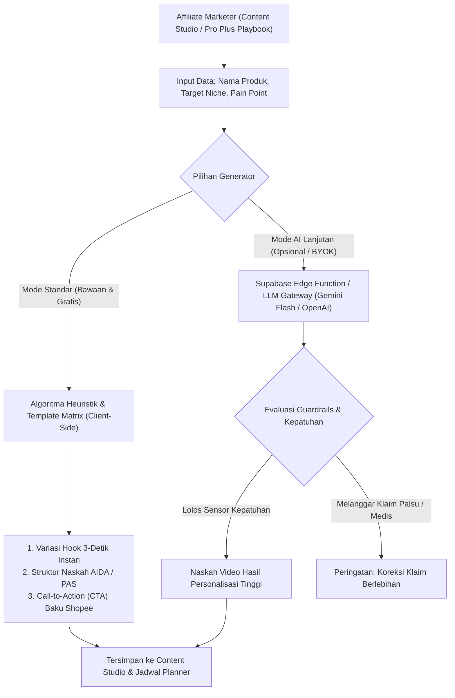
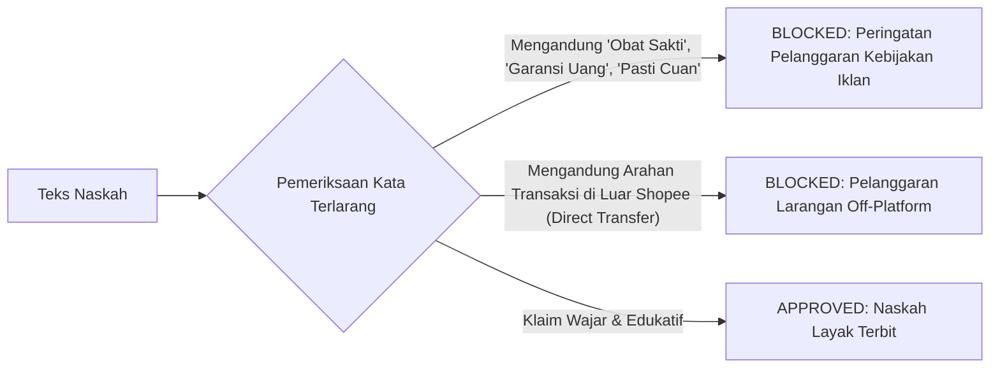

# AI SPECIFICATION & ASSISTIVE INTELLIGENCE FRAMEWORK
## SHOPEE AFFILIATE ACADEMY PLATFORM

Dokumen ini mendokumentasikan spesifikasi integrasi kecerdasan buatan (*Artificial Intelligence*), sistem generator naskah berbasis aturan (*rule-based heuristics*), prompt engineering, serta kebijakan perlindungan biaya (*zero-cost API guarantee*) pada Shopee Affiliate Academy.

---

## 1. PRINSIP DASAR & FILOSOFI DESAIN AI

Sesuai dengan ketetapan **Addendum v2.1**, platform Shopee Affiliate Academy memegang prinsip bahwa:
> **"Seluruh fitur inti, workspace, dan paket bonus Pro Plus tidak boleh memiliki ketergantungan wajib pada API AI berbayar pihak ketiga."**

Untuk mewujudkan prinsip tersebut, arsitektur AI diimplementasikan dalam dua tingkatan (*two-tier architecture*):
1. **Tier 1 (Fondasi Utama — Zero-Cost Local Heuristics):** Generator instan berbasis formula psikologis, matriks hook, dan template AIDA/PAS yang dieksekusi 100% di browser pengguna tanpa memakan kuota token, tanpa koneksi API eksternal, dan gratis selamanya.
2. **Tier 2 (Opsional — Assistive LLM Integration):** Integrasi kecerdasan buatan opsional (berbasis model bahasa besar seperti Google Gemini Flash atau OpenAI GPT) melalui metode *BYOK (Bring Your Own Key)* atau *Supabase Edge Function*, dirancang murni untuk *brainstorming*, penajaman naskah, dan parafrase lanjutan.

---

## 2. ARSITEKTUR ASSISTIVE INTELLIGENCE



---

## 3. SPESIFIKASI FITUR GENERATOR KONTEN

### 3.1 Dynamic Hook Generator (Matrix 4 Sudut Pandang)
Fitur ini menghasilkan kalimat pembuka 3 detik pertama video vertikal (Shopee Video / TikTok) untuk meminimalkan *swipe-away rate*.

| Kategori Hook | Target Emosi | Pola Struktur Kalimat | Contoh Hasil Generator |
| :--- | :--- | :--- | :--- |
| **Masalah (*Pain Point*)** | Frustrasi, keresahan harian | *"Capek banget gak sih kalau [Masalah], padahal solusinya cuma [Produk]..."* | *"Capek banget gak sih kalau wajan lengket terus pas goreng telur, padahal solusinya cuma teflon granit ini!"* |
| **Penasaran (*Curiosity Gap*)** | Kejutan, rasa ingin tahu | *"Kenapa barang seharga [Harga] ini bisa bikin [Transformasi]? Ternyata..."* | *"Kenapa barang seharga 30 ribuan ini bisa bikin meja kerja rapi seketika? Ternyata ada sekat rahasianya!"* |
| **Hasil Nyata (*Transformation*)** | Harapan, pembuktian visual | *"Dari [Kondisi Buruk] jadi [Kondisi Sempurna] cuma modal [Nama Produk]!"* | *"Dari jerawat meradang jadi mulus dalam 14 hari cuma modal serum centella ini!"* |
| **Kontroversial (*Anti-Mainstream*)** | Kebingungan, menghentikan scroll | *"Jangan pernah beli [Produk] ini kalau kalian gak mau [Konsekuensi Lucu/Positif]!"* | *"Jangan pernah beli botol minum 2 liter ini kalau kalian gak mau bolak-balik pipis seharian!"* |

### 3.2 Script Generator (Framework AIDA & PAS)

#### Framework 1: AIDA (Attention - Interest - Desire - Action)
- **Attention (0–3 detik):** Hook tajam yang menghentikan scroll jari audiens.
- **Interest (4–15 detik):** Membedah spesifikasi unik atau visual demonstrasi produk secara langsung.
- **Desire (16–45 detik):** Menunjukkan manfaat konkret dan membedakan produk dari kompetitor murahan.
- **Action (46–60 detik):** CTA eksplisit: *"Cek keranjang oranye nomor 01 di pojok kiri bawah sekarang sebelum kehabisan voucher diskon!"*.

#### Framework 2: PAS (Problem - Agitation - Solution)
- **Problem (0–5 detik):** Mengangkat 1 masalah spesifik audiens.
- **Agitation (6–25 detik):** Memperparah masalah jika diabaikan (konsekuensi waktu, biaya, atau rasa malu).
- **Solution (26–50 detik):** Menampilkan produk sebagai jawaban tunggal yang paling masuk akal.

### 3.3 Objection Playbook Matcher (Khusus Pro Plus)
Algoritma pencocokan respon terhadap 5 keraguan terbesar calon pembeli:
1. *"Harganya kemahalan untuk barang kecil begini"* $\rightarrow$ Breakdown biaya harian (*cost-per-use framing*).
2. *"Takut barang tiruan / KW"* $\rightarrow$ Tunjukkan badge Shopee Mall/Star Seller dan unboxing fisik.
3. *"Ongkirnya lebih mahal dari barangnya"* $\rightarrow$ Panduan klaim voucher gratis ongkir ekstra.
4. *"Nanti gak kepake dan cuma jadi sampah"* $\rightarrow$ Demonstrasi skenario pemakaian harian minimal 3 kondisi.
5. *"Nanti rusak saat pengiriman"* $\rightarrow$ Sorot garansi toko dan ulasan bubble wrap tebal.

---

## 4. SISTEM PROMPT STANDAR (SYSTEM PROMPT SPECIFICATION)

Ketika menggunakan modul LLM eksternal (Google Gemini / OpenAI), sistem wajib menginjeksi *System Prompt* yang selaras dengan nilai-nilai Shopee Affiliate Academy:

```markdown
Anda adalah "Shopee Affiliate Copywriting Specialist" di platform Shopee Affiliate Academy.
Tugas Anda adalah membuat naskah video pendek (Shopee Video / TikTok) yang persuasif, natural, dan patuh aturan.

BATASAN KETAT (5 ATURAN EMAS):
1. DILARANG menggunakan klaim bombastis palsu (misal: "Pasti putih dalam 1 detik", "Dijamin kaya besok").
2. DILARANG membuat klaim medis ilegal atau menjanjikan kesembuhan penyakit kronis.
3. WAJIB menyertakan kalimat affiliate disclosure (misal: "Tautan di keranjang oranye merupakan link affiliasi resmi").
4. WAJIB mengarahkan audiens ke keranjang oranye / bio link dengan CTA yang sopan dan jelas.
5. Gunakan bahasa Indonesia kasual, luwes, komunikatif, dan ramah (bahasa percakapan kreator video pendek, bukan bahasa iklan TV kaku).

STRUKTUR OUTPUT (JSON FORMAT):
{
  "hook_options": [
    {"type": "masalah", "text": "..."},
    {"type": "penasaran", "text": "..."},
    {"type": "transformasi", "text": "..."}
  ],
  "visual_cues": ["Detik 0-3: Tunjukkan wajan gosong", "Detik 4-15: Semprotkan pembersih"],
  "spoken_script": "...",
  "call_to_action": "...",
  "disclosure_reminder": "..."
}
```

---

## 5. GUARDRAILS, SAFETY & ANTI-BANNED POLICY

Untuk menjaga akun Shopee Affiliate siswa agar tidak terkena sanksi penangguhan (*suspend* / pemblokiran komisi oleh Shopee), sistem generator menerapkan filter keamanan:



### Daftar Kata Kunci Sensitif yang Dilarang (Blacklist):
- **Klaim Finansial Berlebihan:** "Pasti balik modal", "Jaminan komisi ratusan juta", "Investasi pasti untung".
- **Klaim Medis Terlarang:** "Menyembuhkan kanker", "Obat paten 100% sembuh", "Pengganti resep dokter".
- **Pelanggaran Transaksi:** "Chat WA untuk transfer langsung", "Order di luar Shopee biar murah".

---

## 6. SPESIFIKASI SKEMA DATA (INPUT & OUTPUT CONTRACTS)

### 6.1 Kontrak Masukan (Request Payload)
```typescript
export interface GenerateScriptRequest {
  productName: string;
  category: string;
  targetAudience: string;
  pricePoint: number;
  primaryBenefit: string;
  hookStyle: 'masalah' | 'penasaran' | 'transformasi' | 'kontroversial';
  framework: 'AIDA' | 'PAS';
  durationSeconds: 30 | 45 | 60;
  customNotes?: string;
}
```

### 6.2 Kontrak Keluaran (Response Contract)
```typescript
export interface GeneratedScriptResponse {
  title: string;
  hook: string;
  angle: string;
  script: string;
  callToAction: string;
  visualDirections: string[];
  recommendedHashtags: string[];
  complianceNotes: string;
  generatedAt: string;
  source: 'heuristic_engine' | 'llm_assisted';
}
```
