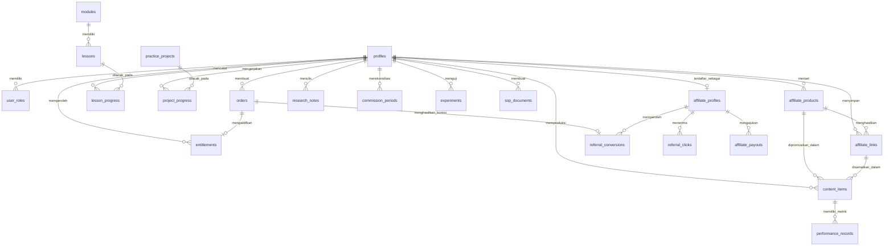

# DATABASE SPECIFICATION & SCHEMA DICTIONARY
## SHOPEE AFFILIATE ACADEMY PLATFORM (PostgreSQL 15+ via Supabase)

Dokumen ini mendokumentasikan skema database resmi, kamus data (*data dictionary*), relasi antar-entitas (ERD), fungsi tersimpan (*stored procedures*), pemicu (*triggers*), serta aturan keamanan tingkat baris (*Row Level Security - RLS*) untuk Shopee Affiliate Academy.

---

## 1. ENTITY RELATIONSHIP DIAGRAM (ERD)



---

## 2. TIPE DATA KHUSUS (ENUMS)

```sql
-- Peran Pengguna Platform
CREATE TYPE user_role_enum AS ENUM ('student', 'admin', 'super_admin');
```

---

## 3. KAMUS DATA (23 TABEL PRODUKSI)

### 3.1 Tabel Entitas Pengguna, Hak Akses & Audit

#### 1. `profiles`
Menyimpan data publik & profil operasional pengguna yang terhubung langsung dengan `auth.users`.
| Kolom | Tipe | Nullable | Default | Keterangan |
| :--- | :--- | :---: | :--- | :--- |
| `id` | UUID (PK) | NO | - | Foreign Key ke `auth.users(id)` ON DELETE CASCADE |
| `display_name` | TEXT | NO | - | Nama lengkap atau display name siswa |
| `avatar_url` | TEXT | YES | NULL | URL foto avatar profil |
| `phone_number` | TEXT | YES | NULL | Nomor WhatsApp untuk konfirmasi/layanan |
| `created_at` | TIMESTAMPTZ | NO | NOW() | Waktu profil dibuat |
| `updated_at` | TIMESTAMPTZ | NO | NOW() | Waktu profil diperbarui |

#### 2. `user_roles`
Menentukan hak istimewa pengguna (RBAC: student, admin, super_admin).
| Kolom | Tipe | Nullable | Default | Keterangan |
| :--- | :--- | :---: | :--- | :--- |
| `id` | UUID (PK) | NO | gen_random_uuid() | ID unik baris peran |
| `user_id` | UUID (FK) | NO | - | FK ke `profiles(id)` ON DELETE CASCADE |
| `role` | user_role_enum | NO | 'student' | Nilai peran: student, admin, super_admin |
| `created_at` | TIMESTAMPTZ | NO | NOW() | Waktu penetapan peran |
| *Constraint* | UNIQUE (user_id, role) | - | - | Mencegah duplikasi peran per user |

#### 3. `orders`
Mencatat transaksi pembelian paket kursus oleh pengguna.
| Kolom | Tipe | Nullable | Default | Keterangan |
| :--- | :--- | :---: | :--- | :--- |
| `id` | UUID (PK) | NO | gen_random_uuid() | ID pesanan internal |
| `order_number` | TEXT | NO | - | Nomor invoice unik (misal: SAA-20261026-001) |
| `user_id` | UUID (FK) | YES | NULL | FK ke `profiles(id)` ON DELETE SET NULL |
| `customer_email` | TEXT | NO | - | Email pembeli saat checkout |
| `amount` | NUMERIC(12,2)| NO | - | Nilai nominal yang harus dibayar |
| `currency` | TEXT | NO | 'IDR' | Mata uang pembayaran |
| `provider` | TEXT | NO | - | Kanal: lynk, dana_qris, manual, xendit |
| `provider_reference` | TEXT | YES | NULL | Nomor referensi/transaksi dari penyedia |
| `status` | TEXT | NO | 'pending' | pending, paid, cancelled, refunded, failed |
| `paid_at` | TIMESTAMPTZ | YES | NULL | Waktu pembayaran terkonfirmasi lunas |
| `created_at` | TIMESTAMPTZ | NO | NOW() | Waktu order diterbitkan |
| `updated_at` | TIMESTAMPTZ | NO | NOW() | Waktu update terakhir |

#### 4. `entitlements`
Menyimpan hak akses aktif pengguna terhadap paket kursus (Free, Pro, Pro Plus).
| Kolom | Tipe | Nullable | Default | Keterangan |
| :--- | :--- | :---: | :--- | :--- |
| `id` | UUID (PK) | NO | gen_random_uuid() | ID unik entitlement |
| `user_id` | UUID (FK) | NO | - | FK ke `profiles(id)` ON DELETE CASCADE |
| `product_code` | TEXT | NO | 'affiliate_academy' | Kode produk platform |
| `access_level` | TEXT | NO | 'premium' | Level akses: free, pro, pro_plus, premium |
| `status` | TEXT | NO | 'active' | active, revoked, expired |
| `source_order_id` | UUID (FK) | YES | NULL | FK ke `orders(id)` jika berasal dari order |
| `granted_at` | TIMESTAMPTZ | NO | NOW() | Waktu hak akses diberikan |
| `revoked_at` | TIMESTAMPTZ | YES | NULL | Waktu hak akses dicabut |
| `revocation_reason`| TEXT | YES | NULL | Alasan pencabutan (jika ada) |
| `created_at` | TIMESTAMPTZ | NO | NOW() | Waktu pembuatan baris |
| *Constraint* | UNIQUE (user_id, product_code) | - | - | Satu hak akses per produk per user |

#### 5. `admin_audit_logs`
Merekam seluruh aksi sensitif yang dilakukan admin di dashboard.
| Kolom | Tipe | Nullable | Default | Keterangan |
| :--- | :--- | :---: | :--- | :--- |
| `id` | UUID (PK) | NO | gen_random_uuid() | ID unik log |
| `admin_user_id` | UUID (FK) | NO | - | FK ke `profiles(id)` aktor admin |
| `action` | TEXT | NO | - | Jenis aksi: grant_entitlement, revoke_access, approve_payout, reject_payout |
| `target_user_id` | UUID (FK) | YES | NULL | FK ke `profiles(id)` target |
| `related_order_id`| UUID (FK) | YES | NULL | FK ke `orders(id)` terkait |
| `reason` | TEXT | YES | NULL | Alasan manual yang dimasukkan admin |
| `metadata` | JSONB | YES | '{}'::jsonb | Data tambahan konteks aksi |
| `created_at` | TIMESTAMPTZ | NO | NOW() | Timestamp eksekusi aksi |

---

### 3.2 Tabel Kurikulum & Pelacakan Belajar (LMS)

#### 6. `modules`
Daftar 7 Modul Platform (M00 hingga M06).
| Kolom | Tipe | Nullable | Default | Keterangan |
| :--- | :--- | :---: | :--- | :--- |
| `id` | UUID (PK) | NO | gen_random_uuid() | ID unik modul |
| `code` | TEXT | NO | - | Kode unik (M00, M01, s/d M06) |
| `title` | TEXT | NO | - | Judul modul platform |
| `slug` | TEXT | NO | - | URL slug unik modul |
| `description` | TEXT | YES | NULL | Ringkasan materi yang dipelajari |
| `sort_order` | INT | NO | 0 | Urutan tampilan modul |
| `is_published` | BOOLEAN | NO | true | Visibilitas tayang |

#### 7. `lessons`
Daftar 30 Pelajaran materi kurikulum.
| Kolom | Tipe | Nullable | Default | Keterangan |
| :--- | :--- | :---: | :--- | :--- |
| `id` | UUID (PK) | NO | gen_random_uuid() | ID unik pelajaran |
| `module_id` | UUID (FK) | NO | - | FK ke `modules(id)` ON DELETE CASCADE |
| `title` | TEXT | NO | - | Judul pelajaran |
| `slug` | TEXT | NO | - | Slug pelajaran unik per modul |
| `content` | TEXT | NO | - | Konten materi dalam format Markdown |
| `source_ref` | TEXT | YES | NULL | Referensi file kurikulum asli |
| `estimated_minutes`| INT | NO | 10 | Estimasi durasi baca dalam menit |
| `is_free_preview` | BOOLEAN | NO | false | Apakah pelajaran dapat diakses tier Free |
| `sort_order` | INT | NO | 0 | Urutan pelajaran dalam modul |
| `is_published` | BOOLEAN | NO | true | Status tayang |
| *Constraint* | UNIQUE (module_id, slug) | - | - | Slug unik dalam cakupan modul |

#### 8. `lesson_progress`
Mencatat status penyelesaian pelajaran per pengguna.
| Kolom | Tipe | Nullable | Default | Keterangan |
| :--- | :--- | :---: | :--- | :--- |
| `id` | UUID (PK) | NO | gen_random_uuid() | ID unik baris progres |
| `user_id` | UUID (FK) | NO | - | FK ke `profiles(id)` ON DELETE CASCADE |
| `lesson_id` | UUID (FK) | NO | - | FK ke `lessons(id)` ON DELETE CASCADE |
| `is_completed` | BOOLEAN | NO | false | True jika telah ditandai selesai |
| `completed_at` | TIMESTAMPTZ | YES | NULL | Waktu penyelesaian |
| `updated_at` | TIMESTAMPTZ | NO | NOW() | Waktu update terakhir |
| *Constraint* | UNIQUE (user_id, lesson_id) | - | - | Satu baris progres per pelajaran |

#### 9. `practice_projects`
Daftar 8 Proyek Praktik Wajib (P01–P08).
| Kolom | Tipe | Nullable | Default | Keterangan |
| :--- | :--- | :---: | :--- | :--- |
| `id` | UUID (PK) | NO | gen_random_uuid() | ID proyek praktik |
| `code` | TEXT | NO | - | Kode proyek (P01 sampai P08) |
| `title` | TEXT | NO | - | Judul proyek praktik |
| `objective` | TEXT | NO | - | Capaian nyata yang ditargetkan |
| `supporting_modules`| JSONB | NO | '[]'::jsonb | Array kode modul pendukung |
| `checklist` | JSONB | NO | '[]'::jsonb | Daftar butir verifikasi praktik |
| `sort_order` | INT | NO | 0 | Urutan proyek |
| `is_published` | BOOLEAN | NO | true | Status publikasi |

#### 10. `project_progress`
Pencatatan hasil kerja proyek praktik per pengguna.
| Kolom | Tipe | Nullable | Default | Keterangan |
| :--- | :--- | :---: | :--- | :--- |
| `id` | UUID (PK) | NO | gen_random_uuid() | ID progres pengerjaan |
| `user_id` | UUID (FK) | NO | - | FK ke `profiles(id)` ON DELETE CASCADE |
| `project_id` | UUID (FK) | NO | - | FK ke `practice_projects(id)` |
| `completed_checklist`| JSONB | NO | '[]'::jsonb| Array ID butir yang telah dicentang |
| `reflection_notes` | TEXT | YES | NULL | Catatan refleksi & evaluasi mandiri |
| `evidence_urls` | JSONB | NO | '[]'::jsonb| Daftar link bukti kerja nyata |
| `status` | TEXT | NO | 'not_started'| not_started, in_progress, completed |
| `started_at` | TIMESTAMPTZ | YES | NULL | Waktu mulai mengerjakan |
| `completed_at` | TIMESTAMPTZ | YES | NULL | Waktu status menjadi completed |
| `updated_at` | TIMESTAMPTZ | NO | NOW() | Update timestamp |
| *Constraint* | UNIQUE (user_id, project_id) | - | - | Satu progres per proyek per user |

---

### 3.3 Tabel Enam Workspace Operasional

#### 11. `affiliate_products` (Product Research Lab)
Menyimpan database produk riset affiliate dengan skor evaluasi 7 faktor.
| Kolom | Tipe | Nullable | Default | Keterangan |
| :--- | :--- | :---: | :--- | :--- |
| `id` | UUID (PK) | NO | gen_random_uuid() | ID produk riset |
| `user_id` | UUID (FK) | NO | - | FK ke `profiles(id)` ON DELETE CASCADE |
| `name` | TEXT | NO | - | Nama produk |
| `product_url` | TEXT | NO | - | Tautan URL produk di Shopee |
| `category` | TEXT | YES | NULL | Kategori produk |
| `price` | NUMERIC(12,2)| NO | 0 | Harga jual produk |
| `commission_note` | TEXT | YES | NULL | Catatan estimasi komisi |
| `rating` | NUMERIC(3,2)| YES | NULL | Rating toko/produk Shopee |
| `review_count` | INT | YES | 0 | Jumlah review pembeli |
| `checked_at` | DATE | NO | CURRENT_DATE | Tanggal produk diperiksa |
| `score_audience_fit` | INT (1-5) | YES | NULL | Faktor 1: Kesesuaian Audiens |
| `score_quality` | INT (1-5) | YES | NULL | Faktor 2: Kualitas Produk |
| `score_price_value`| INT (1-5) | YES | NULL | Faktor 3: Rasio Harga/Nilai |
| `score_commission` | INT (1-5) | YES | NULL | Faktor 4: Potensi Komisi |
| `score_competition` | INT (1-5) | YES | NULL | Faktor 5: Tingkat Persaingan |
| `score_demo_potential`| INT (1-5)| YES | NULL | Faktor 6: Kemudahan Demo Visual |
| `score_availability`| INT (1-5) | YES | NULL | Faktor 7: Stok & Kredibilitas Toko |
| `research_score` | NUMERIC(5,2)| YES | NULL | Rata-rata terhitung (1.00 - 5.00) |
| `status` | TEXT | NO | 'research' | research, ready, testing, dropped |
| `notes` | TEXT | YES | NULL | Catatan tambahan riset |

#### 12. `research_notes` (Catatan Riset Niche & Kompetitor)
| Kolom | Tipe | Nullable | Default | Keterangan |
| :--- | :--- | :---: | :--- | :--- |
| `id` | UUID (PK) | NO | gen_random_uuid() | ID catatan riset |
| `user_id` | UUID (FK) | NO | - | FK ke `profiles(id)` ON DELETE CASCADE |
| `note_type` | TEXT | NO | - | Tipe: 'niche' atau 'competitor' |
| `title` | TEXT | NO | - | Judul catatan |
| `subject` | TEXT | NO | - | Subjek riset (nama niche / akun kompetitor) |
| `findings` | TEXT | YES | NULL | Temuan utama |
| `evidence_urls` | JSONB | YES | '[]'::jsonb | Bukti link video / akun kompetitor |
| `observed_at` | DATE | NO | CURRENT_DATE | Tanggal pengamatan |
| `facts` | TEXT | YES | NULL | Fakta objektif di lapangan |
| `assumptions` | TEXT | YES | NULL | Asumsi awal yang dibuktikan |
| `content_gaps` | TEXT | YES | NULL | Celah konten yang bisa dimasuki |
| `next_step` | TEXT | YES | NULL | Rencana aksi lanjutan |

#### 13. `content_templates` (Template Hook, Script, CTA)
| Kolom | Tipe | Nullable | Default | Keterangan |
| :--- | :--- | :---: | :--- | :--- |
| `id` | UUID (PK) | NO | gen_random_uuid() | ID template |
| `kind` | TEXT | NO | - | hook, script, cta, checklist |
| `subtype` | TEXT | YES | NULL | Subkategori (masalah, penasaran, dll) |
| `title` | TEXT | NO | - | Judul template |
| `body` | TEXT | NO | - | Teks isi template |
| `sort_order` | INT | YES | 0 | Urutan tampilan |
| `is_published` | BOOLEAN | NO | true | Status aktif |

#### 14. `affiliate_links` (Link Archive & Pelacakan Tautan)
| Kolom | Tipe | Nullable | Default | Keterangan |
| :--- | :--- | :---: | :--- | :--- |
| `id` | UUID (PK) | NO | gen_random_uuid() | ID tautan |
| `user_id` | UUID (FK) | NO | - | FK ke `profiles(id)` ON DELETE CASCADE |
| `product_id` | UUID (FK) | YES | NULL | FK ke `affiliate_products(id)` |
| `shop_name` | TEXT | YES | NULL | Nama toko Shopee |
| `url` | TEXT | NO | - | Tautan affiliate Shopee (shortlink/deep link) |
| `platform` | TEXT | NO | - | Shopee Video, TikTok, IG, FB |
| `status` | TEXT | NO | 'active' | active, needs_check, unused |
| `checked_at` | DATE | YES | CURRENT_DATE | Tanggal terakhir dicek keaktifannya |
| `notes` | TEXT | YES | NULL | Catatan sub-tag atau penempatan |

#### 15. `content_items` (Content Creation Studio & Content Planner)
| Kolom | Tipe | Nullable | Default | Keterangan |
| :--- | :--- | :---: | :--- | :--- |
| `id` | UUID (PK) | NO | gen_random_uuid() | ID item konten |
| `user_id` | UUID (FK) | NO | - | FK ke `profiles(id)` ON DELETE CASCADE |
| `product_id` | UUID (FK) | YES | NULL | FK ke `affiliate_products(id)` |
| `link_id` | UUID (FK) | YES | NULL | FK ke `affiliate_links(id)` |
| `title` | TEXT | NO | - | Judul / topik konten |
| `platform` | TEXT | NO | - | Target channel distribusi |
| `pillar` | TEXT | YES | NULL | Pilar konten (Demo, Edukasi, Review, Solusi) |
| `format` | TEXT | YES | NULL | Format (Video Vertikal 9:16, Carousel, Text) |
| `hook_type` | TEXT | YES | NULL | Tipe hook psikologis yang dipilih |
| `hook` | TEXT | YES | NULL | Kalimat 3 detik pertama pembuka video |
| `angle` | TEXT | YES | NULL | Sudut pandang pesan |
| `script` | TEXT | YES | NULL | Naskah lengkap konten |
| `cta` | TEXT | YES | NULL | Kalimat ajakan bertindak ke link affiliate |
| `has_disclosure`| BOOLEAN | NO | true | Penanda kepatuhan disclosure affiliate |
| `qc_checklist` | JSONB | YES | '{}'::jsonb | Nilai butir 11-point QC sebelum tayang |
| `status` | TEXT | NO | 'idea' | idea, research, script, production, review, ready, published, evaluation, done |
| `scheduled_at` | TIMESTAMPTZ | YES | NULL | Jadwal rencana rilis |
| `published_at` | TIMESTAMPTZ | YES | NULL | Waktu aktual rilis |
| `content_url` | TEXT | YES | NULL | URL konten setelah dipublikasikan |

#### 16. `performance_records` (Catatan Metrik Konten Harian)
| Kolom | Tipe | Nullable | Default | Keterangan |
| :--- | :--- | :---: | :--- | :--- |
| `id` | UUID (PK) | NO | gen_random_uuid() | ID metrik |
| `user_id` | UUID (FK) | NO | - | FK ke `profiles(id)` ON DELETE CASCADE |
| `content_item_id`| UUID (FK) | NO | - | FK ke `content_items(id)` ON DELETE CASCADE |
| `record_date` | DATE | NO | - | Tanggal pencatatan performa |
| `views` | INT | YES | 0 | Jumlah tayangan video/konten |
| `clicks` | INT | YES | 0 | Jumlah klik tautan affiliate |
| `orders` | INT | YES | 0 | Total pesanan yang terjadi |
| `cancelled_orders`| INT | YES | 0 | Jumlah pesanan yang dibatalkan/retur |
| `qualified_orders`| INT | YES | 0 | Jumlah pesanan sah yang menghasilkan komisi |
| `commission_estimated`| NUMERIC(12,2)| YES | 0 | Estimasi komisi kotor |
| `commission_pending` | NUMERIC(12,2)| YES | 0 | Komisi berstatus menunggu |
| `commission_approved`| NUMERIC(12,2)| YES | 0 | Komisi berstatus disetujui |
| `commission_paid` | NUMERIC(12,2)| YES | 0 | Komisi yang telah ditransfer Shopee |
| `notes` | TEXT | YES | NULL | Analisis alasan fluktuasi angka |
| *Constraint* | UNIQUE (content_item_id, record_date) | - | - | Satu catatan per item per hari |

#### 17. `commission_periods` (Performance Tracker Rekonsiliasi Komisi)
| Kolom | Tipe | Nullable | Default | Keterangan |
| :--- | :--- | :---: | :--- | :--- |
| `id` | UUID (PK) | NO | gen_random_uuid() | ID rekonsiliasi periode |
| `user_id` | UUID (FK) | NO | - | FK ke `profiles(id)` ON DELETE CASCADE |
| `period_label` | TEXT | NO | - | Label periode (misal: "Minggu 1 Oktober 2026") |
| `start_date` | DATE | NO | - | Tanggal awal periode |
| `end_date` | DATE | NO | - | Tanggal akhir periode |
| `source_name` | TEXT | NO | 'Shopee Official Dashboard' | Sumber data pelaporan |
| `clicks` | INT | YES | 0 | Total klik periode |
| `orders` | INT | YES | 0 | Total pesanan periode |
| `commission_estimated`| NUMERIC(12,2)| YES | 0 | Komisi estimasi |
| `commission_approved` | NUMERIC(12,2)| YES | 0 | Komisi sah |
| `business_costs` | NUMERIC(12,2)| YES | 0 | Biaya operasional (beli sampel, kuota) |
| `work_hours` | NUMERIC(6,2)| YES | 0 | Jam kerja yang dialokasikan |
| `reconciliation_notes` | TEXT | YES | NULL | Catatan perbandingan data Shopee vs estimasi |

#### 18. `experiments` (Experiment Tracker Uji Hipotesis)
| Kolom | Tipe | Nullable | Default | Keterangan |
| :--- | :--- | :---: | :--- | :--- |
| `id` | UUID (PK) | NO | gen_random_uuid() | ID eksperimen |
| `user_id` | UUID (FK) | NO | - | FK ke `profiles(id)` ON DELETE CASCADE |
| `name` | TEXT | NO | - | Nama eksperimen |
| `goal` | TEXT | NO | - | Target yang ingin dicapai |
| `hypothesis` | TEXT | NO | - | Pernyataan hipotesis ("Jika X maka Y") |
| `variable` | TEXT | NO | - | 1 Variabel bebas yang diuji |
| `primary_metric`| TEXT | NO | - | Metrik penentu (CTR, CVR, EPC, AOV) |
| `baseline` | NUMERIC(12,2)| YES | NULL | Nilai dasar sebelum pengujian |
| `result` | NUMERIC(12,2)| YES | NULL | Nilai hasil setelah pengujian |
| `start_date` | DATE | NO | - | Tanggal mulai uji |
| `end_date` | DATE | NO | - | Tanggal selesai uji |
| `decision` | TEXT | YES | NULL | continue, optimize, retest, deprioritize, stop |
| `decision_reason`| TEXT | YES | NULL | Alasan rasional pengambilan keputusan |
| `lessons` | TEXT | YES | NULL | Pembelajaran yang didapat |

#### 19. `sop_documents` (Standard Operating Procedures)
| Kolom | Tipe | Nullable | Default | Keterangan |
| :--- | :--- | :---: | :--- | :--- |
| `id` | UUID (PK) | NO | gen_random_uuid() | ID dokumen SOP |
| `user_id` | UUID (FK) | NO | - | FK ke `profiles(id)` ON DELETE CASCADE |
| `title` | TEXT | NO | - | Judul standar prosedur |
| `category` | TEXT | NO | - | Kategori (Riset, Naskah, Shooting, QC) |
| `procedure` | TEXT | NO | - | Langkah prosedur terperinci |
| `last_reviewed_at`| DATE | YES | CURRENT_DATE | Tanggal audit terakhir |
| `review_notes` | TEXT | YES | NULL | Catatan pembaruan prosedur |

---

### 3.4 Tabel Program Kemitraan Affiliate Internal

#### 20. `affiliate_profiles`
Profil afiliasi pengguna platform untuk mereferensikan siswa baru.
| Kolom | Tipe | Nullable | Default | Keterangan |
| :--- | :--- | :---: | :--- | :--- |
| `id` | UUID (PK) | NO | gen_random_uuid() | ID unik profil affiliate |
| `user_id` | UUID (FK) | NO | - | FK ke `profiles(id)` ON DELETE CASCADE UNIQUE |
| `referral_code` | TEXT | NO | - | Kode unik referral (misal: 'ANDI2026') UNIQUE |
| `bank_name` | TEXT | YES | NULL | Nama bank tujuan transfer komisi |
| `bank_account_number`| TEXT | YES | NULL | Nomor rekening bank / e-wallet |
| `bank_account_holder`| TEXT | YES | NULL | Nama pemilik rekening sesuai buku tabungan |
| `is_active` | BOOLEAN | NO | true | Status kemitraan aktif |
| `total_commission_earned`| NUMERIC(12,2)| NO | 0 | Akumulasi komisi yang diperoleh |
| `total_commission_paid` | NUMERIC(12,2)| NO | 0 | Akumulasi komisi yang telah ditransfer |

#### 21. `referral_clicks`
Pencatatan klik tautan referral internal untuk keperluan analitik.
| Kolom | Tipe | Nullable | Default | Keterangan |
| :--- | :--- | :---: | :--- | :--- |
| `id` | UUID (PK) | NO | gen_random_uuid() | ID klik |
| `affiliate_id` | UUID (FK) | NO | - | FK ke `affiliate_profiles(id)` ON DELETE CASCADE |
| `ip_hash` | TEXT | YES | NULL | Hash anonim IP pengunjung untuk anti-bot |
| `user_agent` | TEXT | YES | NULL | Data browser pengunjung |
| `referer_url` | TEXT | YES | NULL | Sumber tautan awal (Instagram, TikTok, WA) |
| `created_at` | TIMESTAMPTZ | NO | NOW() | Waktu klik terjadi |

#### 22. `referral_conversions`
Pencatatan transaksi yang menghasilkan komisi kemitraan internal.
| Kolom | Tipe | Nullable | Default | Keterangan |
| :--- | :--- | :---: | :--- | :--- |
| `id` | UUID (PK) | NO | gen_random_uuid() | ID konversi |
| `affiliate_id` | UUID (FK) | NO | - | FK ke `affiliate_profiles(id)` ON DELETE CASCADE |
| `order_id` | UUID (FK) | NO | - | FK ke `orders(id)` ON DELETE CASCADE UNIQUE |
| `commission_rate`| NUMERIC(4,2)| NO | 0.10 | Persentase komisi baku (10%) |
| `commission_amount`| NUMERIC(12,2)| NO | - | Nilai rupiah komisi (10% x net order) |
| `status` | TEXT | NO | 'pending' | pending, approved, rejected, paid |
| `created_at` | TIMESTAMPTZ | NO | NOW() | Waktu konversi dicatat |
| `updated_at` | TIMESTAMPTZ | NO | NOW() | Waktu pembaruan status |

#### 23. `affiliate_payouts`
Pencatatan permohonan dan pencairan dana komisi affiliate internal.
| Kolom | Tipe | Nullable | Default | Keterangan |
| :--- | :--- | :---: | :--- | :--- |
| `id` | UUID (PK) | NO | gen_random_uuid() | ID transaksi payout |
| `affiliate_id` | UUID (FK) | NO | - | FK ke `affiliate_profiles(id)` ON DELETE CASCADE |
| `amount` | NUMERIC(12,2)| NO | - | Nilai nominal payout (min Rp50.000) |
| `status` | TEXT | NO | 'requested' | requested, processing, completed, rejected |
| `admin_notes` | TEXT | YES | NULL | Catatan admin pengirim dana |
| `transfer_proof_url`| TEXT | YES | NULL | Bukti transfer bank yang diunggah admin |
| `processed_at` | TIMESTAMPTZ | YES | NULL | Waktu transfer dana selesai |
| `created_at` | TIMESTAMPTZ | NO | NOW() | Waktu pengajuan penarikan |

---

## 4. FUNGSI TERSIMPAN (STORED PROCEDURES) & TRIGGERS

```sql
-- Memeriksa apakah user saat ini memiliki peran Admin/Super Admin
CREATE OR REPLACE FUNCTION public.is_admin()
RETURNS BOOLEAN AS $$
BEGIN
  RETURN EXISTS (
    SELECT 1 FROM public.user_roles
    WHERE user_id = auth.uid() AND role IN ('admin', 'super_admin')
  );
END;
$$ LANGUAGE plpgsql SECURITY DEFINER;

-- Memeriksa apakah user saat ini memiliki hak akses Pro / Pro Plus / Premium
CREATE OR REPLACE FUNCTION public.has_active_premium_access()
RETURNS BOOLEAN AS $$
BEGIN
  IF public.is_admin() THEN
    RETURN TRUE;
  END IF;
  RETURN EXISTS (
    SELECT 1 FROM public.entitlements
    WHERE user_id = auth.uid() 
      AND product_code = 'affiliate_academy' 
      AND status = 'active'
      AND access_level IN ('pro', 'pro_plus', 'premium')
  );
END;
$$ LANGUAGE plpgsql SECURITY DEFINER;

-- Trigger otomatis saat user mendaftar di auth.users (Google OAuth maupun Email)
CREATE OR REPLACE FUNCTION public.handle_new_user()
RETURNS trigger AS $$
BEGIN
  INSERT INTO public.profiles (id, display_name, avatar_url)
  VALUES (
    new.id,
    COALESCE(new.raw_user_meta_data->>'full_name', new.raw_user_meta_data->>'name', split_part(new.email, '@', 1)),
    new.raw_user_meta_data->>'avatar_url'
  );

  INSERT INTO public.user_roles (user_id, role)
  VALUES (new.id, 'student');

  RETURN new;
END;
$$ LANGUAGE plpgsql SECURITY DEFINER;

CREATE OR REPLACE TRIGGER on_auth_user_created
  AFTER INSERT ON auth.users
  FOR EACH ROW EXECUTE PROCEDURE public.handle_new_user();
```

---

## 5. KEBIJAKAN ROW LEVEL SECURITY (RLS) MATRIX

| Nama Tabel | SELECT Policy | INSERT Policy | UPDATE Policy | DELETE Policy |
| :--- | :--- | :--- | :--- | :--- |
| `profiles` | Publik (Authenticated) | Otomatis via Trigger | User Pemilik (`id = auth.uid()`) atau Admin | Admin Saja |
| `user_roles` | User Pemilik atau Admin | Admin Saja | Admin Saja | Admin Saja |
| `orders` | User Pemilik atau Admin | User Terotentikasi | Admin Saja | Admin Saja |
| `entitlements` | User Pemilik atau Admin | Admin Saja | Admin Saja | Admin Saja |
| `admin_audit_logs`| Admin Saja | Admin Saja | Tidak Diizinkan (Immutable) | Tidak Diizinkan |
| `modules` | Publik (Semua Pengguna) | Admin Saja | Admin Saja | Admin Saja |
| `lessons` | Jika `is_free_preview = true` atau `has_active_premium_access()` | Admin Saja | Admin Saja | Admin Saja |
| `lesson_progress` | User Pemilik (`user_id = auth.uid()`) | User Pemilik | User Pemilik | User Pemilik |
| `practice_projects`| Publik (Semua Pengguna) | Admin Saja | Admin Saja | Admin Saja |
| `project_progress`| User Pemilik | User Pemilik (Wajib Pro) | User Pemilik | User Pemilik |
| Workspace Tables (`affiliate_products`, `content_items`, dll.) | User Pemilik (`user_id = auth.uid()`) | User Pemilik | User Pemilik | User Pemilik |
| `affiliate_profiles` | User Pemilik atau Admin | User Terotentikasi | User Pemilik (Rekening) / Admin (Status) | Admin Saja |
| `referral_conversions` | Pemilik Afiliasi atau Admin | Sistem/Webhook Saja | Admin Saja | Admin Saja |
| `affiliate_payouts`| Pemilik Afiliasi atau Admin | Pemilik Afiliasi | Admin Saja | Admin Saja |
