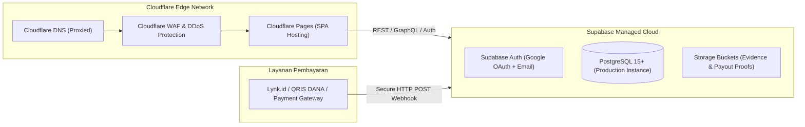

# DEPLOYMENT RUNBOOK & OPERATIONS GUIDE
## SHOPEE AFFILIATE ACADEMY PLATFORM (Cloudflare Pages + Supabase)

Dokumen ini merupakan panduan operasional langkah-demi-langkah (*step-by-step runbook*) untuk melakukan rilis produksi (*production deployment*), pemeliharaan berkala, konfigurasi domain, pemulihan bencana (*disaster recovery*), serta prosedur *rollback*.

---

## 1. TOPOLOGI INFRASTRUKTUR PRODUKSI



---

## 2. CHECKLIST PRA-DEPLOYMENT (PRE-FLIGHT CHECKLIST)

Sebelum memulai deployment ke server produksi, pastikan seluruh parameter berikut terpenuhi:
- [ ] 1. Repository Git bersih dan branch `main` berada pada commit stabil terakhir.
- [ ] 2. Menjalankan verifikasi lokal: `npm run build` sukses tanpa ada error tipe data TypeScript (`tsc`).
- [ ] 3. Seluruh berkas rahasia (`.env`) tidak terunggah ke repositori publik.
- [ ] 4. Proyek baru Supabase untuk environment produksi telah dibuat (*Clean Production Instance*).
- [ ] 5. Akun Cloudflare telah terhubung dengan akun repositori Git (GitHub/GitLab).
- [ ] 6. Kredensial Google Cloud Console untuk OAuth 2.0 Client ID dan Client Secret telah siap.

---

## 3. PROSEDUR DEPLOYMENT PRODUKSI LANGKAH-DEMI-LANGKAH

### Langkah 1: Setup Basis Data Supabase Produksi
1. Buka [Supabase Dashboard](https://supabase.com/dashboard) dan pilih proyek produksi Anda.
2. Masuk ke menu **SQL Editor**.
3. Buka berkas `supabase/migrations/20261026000000_init_schema.sql` dari repositori ini.
4. Salin seluruh isi SQL dan jalankan (*Run*) di SQL Editor Supabase.
5. Verifikasi bahwa 23 tabel telah berhasil dibuat dan seluruh tabel memiliki status **RLS Enabled** (ikon gembok menyala).

### Langkah 2: Konfigurasi Supabase Storage (Buckets)
Buat dua storage bucket privat untuk mengelola unggahan berkas:
1. Bucket `project-evidence`:
   - Akses: Public = `false` (hanya dapat diunggah siswa terotentikasi dan dibaca admin/pemilik).
2. Bucket `payout-proofs`:
   - Akses: Public = `false` (hanya dapat diunggah admin untuk bukti transfer komisi).

Terapkan RLS Storage Policy agar berkas terlindungi dari akses publik liar.

### Langkah 3: Konfigurasi Autentikasi Google OAuth
1. Buka **Google Cloud Console** $\rightarrow$ *APIs & Services* $\rightarrow$ *Credentials*.
2. Buat **OAuth 2.0 Client IDs** bertipe *Web application*.
3. Pada bagian **Authorized redirect URIs**, tambahkan URL callback Supabase:
   ```
   https://<PRODUK_ID_SUPABASE>.supabase.co/auth/v1/callback
   ```
4. Salin *Client ID* dan *Client Secret*.
5. Kembali ke **Supabase Dashboard** $\rightarrow$ *Authentication* $\rightarrow$ *Providers* $\rightarrow$ *Google*.
6. Aktifkan provider Google, tempel *Client ID* dan *Client Secret*, lalu klik **Save**.
7. Pada menu *Authentication* $\rightarrow$ *URL Configuration*:
   - Set **Site URL** ke domain produksi utama (misal: `https://shopeeaffiliateacademy.com`).
   - Masukkan domain yang diizinkan pada **Redirect URLs**.

### Langkah 4: Setup Deployment di Cloudflare Pages
1. Masuk ke [Cloudflare Dashboard](https://dash.cloudflare.com) $\rightarrow$ *Workers & Pages* $\rightarrow$ *Create Application* $\rightarrow$ *Pages* $\rightarrow$ *Connect to Git*.
2. Pilih repositori `shopee-affiliate-academy` dan branch `main`.
3. Pada bagian **Build settings**:
   - **Framework preset:** `Vite`
   - **Build command:** `npm run build`
   - **Build output directory:** `dist`
   - **Root directory:** `/` (kosongkan / default)
4. Pada bagian **Environment variables (Production)**, masukkan nilai:
   ```env
   VITE_SUPABASE_URL=https://<PRODUK_ID_SUPABASE>.supabase.co
   VITE_SUPABASE_ANON_KEY=<KUNCI_ANON_PRODUKSI_SUPABASE>
   VITE_SITE_URL=https://shopeeaffiliateacademy.com
   ```
5. Klik **Save and Deploy**. Cloudflare Pages akan menarik kode, menjalankan build TypeScript, dan mempublikasikan situs ke CDN global.

### Langkah 5: Konfigurasi Single Page App (SPA) Routing & Redirects
Agar perutean React Router (seperti `/modules/M01`, `/dashboard`, `/pricing`) tidak menghasilkan error `404 Not Found` saat pengguna memuat ulang halaman:
- Pastikan berkas `public/_redirects` tersedia dengan isi:
  ```
  /*    /index.html   200
  ```
  *(Cloudflare Pages secara otomatis membaca berkas ini dari folder `dist/` untuk merutekan seluruh permintaan dinamis ke entry point React).*

### Langkah 6: Konfigurasi Custom Domain & DNS
1. Pada Cloudflare Pages project, buka tab **Custom domains** $\rightarrow$ Klik **Set up a custom domain**.
2. Masukkan domain resmi Anda (misal: `shopeeaffiliateacademy.com` atau subdomain `app.shopeeaffiliateacademy.com`).
3. Cloudflare akan mengonfigurasi CNAME DNS dan menerbitkan sertifikat SSL/TLS otomatis dalam hitungan menit.
4. Buka tab **SSL/TLS** di Cloudflare dan pastikan mode enkripsi adalah **Full (Strict)**.

---

## 4. SMOKE TESTING PASCA-DEPLOYMENT (VERIFIKASI RILIS)

Segera setelah deployment selesai, lakukan pemeriksaan cepat (*smoke test*) berikut secara berurutan:
1. **Pemeriksaan Homepage:** Buka domain produksi, pastikan ilustrasi doodle, logo, dan teks tampil rapi.
2. **Pemeriksaan Login Google:** Klik login Google, pastikan pop-up otorisasi muncul dengan nama aplikasi yang benar dan berhasil kembali ke dashboard.
3. **Pemeriksaan Akses Materi M00 (Free):** Buka Pelajaran 01, verifikasi teks kurikulum terbaca utuh.
4. **Pemeriksaan Paywall Pelajaran Berbayar:** Buka Pelajaran 06 dengan akun Free, pastikan modal terkunci muncul dan tidak dapat dibypass via inspect element.
5. **Pemeriksaan Workspace:** Buka *Product Research Lab*, tambahkan 1 produk uji coba, pastikan skor 7 faktor terhitung dan data tersimpan.
6. **Pemeriksaan Link Affiliate:** Buka menu Affiliate, salin link referral `?ref=...`, buka di jendela penyamaran (*incognito*), periksa apakah cookie `sa_ref` terekam.
7. **Pemeriksaan Panel Admin:** Masuk dengan akun admin, verifikasi bahwa menu `/admin` dapat diakses dan daftar pengguna tampil.

---

## 5. PROSEDUR ROLLBACK (JIKA TERJADI INSIDEN KRITIS)

Jika terjadi insiden fatal pada versi yang baru dirilis (misal: kebocoran hak akses atau crash peramban):

### Rollback Frontend (Instan < 30 Detik di Cloudflare Pages):
1. Buka Cloudflare Dashboard $\rightarrow$ *Workers & Pages* $\rightarrow$ Pilih proyek Anda.
2. Buka tab **Deployments**.
3. Cari deployment sebelumnya yang stabil.
4. Klik tombol titik tiga $(\dots)$ pada baris deployment tersebut $\rightarrow$ Pilih **Rollback to this deployment**.
5. Situs produksi akan kembali seketika ke build sebelumnya tanpa waktu henti (*zero downtime*).

### Rollback Database Supabase:
1. Apabila migrasi database terbaru menyebabkan masalah, jalankan skrip SQL pembalik (*down-migration*) spesifik melalui SQL Editor Supabase.
2. Jika terjadi kerusakan data luas, manfaatkan fitur **Point-in-Time Recovery (PITR)** pada menu *Database Settings* Supabase untuk memulihkan database ke titik waktu tepat sebelum insiden terjadi.

---

## 6. MONITORING, LOGGING & RUTINITAS PEMELIHARAAN

1. **Supabase Log Explorer:**
   - Pantau error API pada menu *Logs* $\rightarrow$ *Postgres Logs* & *Auth Logs*.
   - Filter error dengan kode `PGRST` (PostgREST) untuk mendeteksi pelanggaran izin RLS yang tidak terduga.
2. **Cloudflare Web Analytics:**
   - Pantau lalu lintas pengunjung harian, tingkat keberhasilan HTTP status `200`, dan deteksi anomali lonjakan error `5xx`.
3. **Audit Log Admin Rutin:**
   - Administrator utama wajib memeriksa tabel `admin_audit_logs` seminggu sekali untuk memastikan tidak ada pemberian hak comped ilegal atau perubahan status payout yang tidak sah.
4. **Cadangan Data Mandiri (*Offsite Backup*):**
   - Setiap akhir bulan, ekspor dump skema dan data menggunakan perintah:
     ```bash
     supabase db dump -f backup_bulanan.sql
     ```
   - Simpan berkas cadangan terenkripsi di penyimpanan cadangan terpisah.
