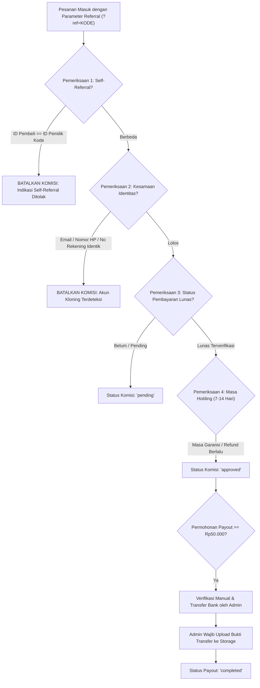

# SECURITY CHECKLIST & HARDENING PROTOCOL
## SHOPEE AFFILIATE ACADEMY PLATFORM

Dokumen ini berisi daftar periksa keamanan (*security checklist*), pemodelan ancaman (*threat modeling*), protokol mitigasi risiko kecurangan (*anti-fraud*), serta prosedur audit kepatuhan untuk platform Shopee Affiliate Academy.

---

## 1. KLASIFIKASI ASET & PEMODELAN ANCAMAN (THREAT MODELING)

| Tingkat Kritis | Jenis Aset | Contoh Data | Potensi Ancaman | Mitigasi Kunci |
| :---: | :--- | :--- | :--- | :--- |
| **Tier 1 (Kritis)** | Hak Akses (*Entitlements*) | Tabel `entitlements` | Injeksi hak akses Pro dari sisi klien tanpa membayar. | RLS mutlak: INSERT/UPDATE hanya boleh dilakukan oleh fungsi backend/Admin berizin. |
| **Tier 1 (Kritis)** | Dana Komisi Affiliate | Tabel `affiliate_payouts`, `referral_conversions` | Pembobolan saldo, klaim komisi fiktif, self-referral berulang. | Payout holding period 7-14 hari, verifikasi rekening, dan pencatatan audit log admin. |
| **Tier 2 (Tinggi)** | Kredensial Pengguna & PII | Email, Password Hash, Nomor WhatsApp, Nomor Rekening | Pembajakan akun (*account takeover*), kebocoran data pribadi. | Supabase GoTrue Auth, enkripsi bcrypt, masking nomor rekening, SSL Strict. |
| **Tier 2 (Tinggi)** | Materi Privat Berbayar | 24 Modul Pelajaran & 3 Bonus Pro Plus | Scraping materi massal, pembajakan link langsung (*hotlinking*). | Proteksi RLS pada kolom konten `lessons`, verifikasi `has_active_premium_access()`. |
| **Tier 3 (Sedang)** | Integritas Audit Admin | Tabel `admin_audit_logs` | Manipulasi jejak rekam oleh oknum internal. | Tabel berstatus *Append-Only* (tidak ada hak UPDATE atau DELETE bagi siapa pun). |

---

## 2. ROW LEVEL SECURITY (RLS) AUDIT MATRIX

Setiap tabel di dalam database PostgreSQL **WAJIB** mengaktifkan RLS (`ENABLE ROW LEVEL SECURITY`). Berikut adalah aturan pengujian kepatuhan izin:

```sql
-- PENGUJIAN 1: Memastikan RLS Aktif di Seluruh Tabel Publik
SELECT tablename, rowsecurity 
FROM pg_tables 
WHERE schemaname = 'public';
-- Hasil verifikasi: Seluruh baris WAJIB bernilai rowsecurity = TRUE.
```

### Matriks Aturan RLS:
1. **Tabel `profiles`:**
   - Pengguna hanya dapat mengubah profilnya sendiri (`id = auth.uid()`).
   - Tidak ada pengguna yang dapat mengubah `id` pengguna lain.
2. **Tabel `orders`:**
   - Pengguna biasa hanya dapat membaca pesanan miliknya (`user_id = auth.uid()`).
   - Perubahan status pesanan menjadi `paid` **DILARANG KERAS** dari frontend klien publik; status hanya boleh diubah oleh Webhook Gateway terverifikasi atau Admin.
3. **Tabel `entitlements`:**
   - Pengguna hanya memiliki izin `SELECT` untuk memeriksa status paketnya sendiri.
   - Izin `INSERT`, `UPDATE`, dan `DELETE` hanya diberikan kepada role `service_role` (Edge Function) dan Administrator yang terverifikasi via `public.is_admin()`.
4. **Tabel `lessons`:**
   - Konten pelajaran dengan `is_free_preview = false` hanya dapat diakses melalui query jika fungsi `public.has_active_premium_access()` mengembalikan nilai `TRUE`.
5. **Tabel `admin_audit_logs`:**
   - Tidak ada peran (termasuk admin) yang memiliki hak `UPDATE` atau `DELETE`. Seluruh histori bersifat kekal (*immutable log*).

---

## 3. PROTOKOL ANTI-FRAUD PROGRAM AFFILIATE INTERNAL

Untuk mencegah kebocoran finansial dari eksploitasi sistem komisi 10%, mekanisme pertahanan berikut wajib diaktifkan:



---

## 4. CHECKLIST KEAMANAN PRA-PRODUKSI (35 BUTIR VERIFIKASI)

### A. Autentikasi & Otorisasi
- [ ] 1. Supabase Auth dikonfigurasi dengan mode PKCE untuk login Google OAuth.
- [ ] 2. Parameter `Site URL` dan `Redirect URLs` di Supabase Dashboard hanya mencantumkan domain resmi produksi dan `localhost` (saat mode dev).
- [ ] 3. Tidak ada kata sandi yang disimpan dalam bentuk plain-text (wajib hashing otomatis via Supabase GoTrue).
- [ ] 4. Sesi pengguna memiliki masa kedaluwarsa wajar (*token refresh cycle*).
- [ ] 5. Proteksi brute-force login aktif secara otomatis pada layer Supabase Auth.

### B. Keamanan Basis Data & RLS
- [ ] 6. Perintah `ALTER TABLE ... ENABLE ROW LEVEL SECURITY;` telah dieksekusi pada seluruh 23 tabel.
- [ ] 7. Fungsi `is_admin()` dideklarasikan dengan klausul `SECURITY DEFINER` dan memverifikasi tabel `user_roles`.
- [ ] 8. Tidak ada endpoint publik yang mengekspos tabel `admin_audit_logs`.
- [ ] 9. Kebijakan RLS membatasi modifikasi data workspace (`affiliate_products`, `content_items`, dll.) hanya untuk pemilik data (`user_id = auth.uid()`).
- [ ] 10. Kolom foreign key memiliki constraint `ON DELETE CASCADE` atau `ON DELETE SET NULL` secara konsisten untuk mencegah data yatim (*orphaned records*).

### C. Pembayaran & Integritas Entitlement
- [ ] 11. Frontend tidak pernah mengirim parameter penentu hak akses (misal: `{ access_level: 'pro' }`) secara langsung ke database.
- [ ] 12. Pembaruan status pesanan menjadi `paid` mewajibkan verifikasi signature kriptografis dari webhook gateway pembayaran.
- [ ] 13. Idempotensi webhook diterapkan: pengiriman notifikasi webhook berulang dengan ID transaksi sama tidak memicu duplikasi komisi affiliate atau duplikasi perpanjangan entitlement.
- [ ] 14. Nomor pesanan (`order_number`) menggunakan format pseudorandom yang tidak dapat ditebak secara berurutan (*non-sequential*).

### D. Anti-Fraud & Kemitraan Affiliate
- [ ] 15. Algoritma deteksi *self-referral* aktif di tingkat database/API.
- [ ] 16. Cookie atribusi affiliate (`sa_ref`) menggunakan atribut `SameSite=Lax` dan batas umur maksimal 30 hari.
- [ ] 17. Penarikan dana komisi mewajibkan akumulasi saldo minimum Rp50.000 dengan status `approved`.
- [ ] 18. Perubahan status payout menjadi `completed` mewajibkan lampiran URL bukti transfer sah di tabel `affiliate_payouts`.
- [ ] 19. Log aktivitas admin tersimpan otomatis setiap kali admin melakukan override akses manual atau persetujuan payout.

### E. Frontend, Jaringan & Infrastruktur
- [ ] 20. Tidak ada *Service Role Key* Supabase (`SUPABASE_SERVICE_KEY`) yang dimasukkan ke dalam berkas `.env` frontend atau bundle JavaScript klien.
- [ ] 21. Berkas `.env` telah dimasukkan ke dalam `.gitignore`.
- [ ] 22. Cloudflare SSL/TLS disetel ke mode **Full (Strict)**.
- [ ] 23. Fitur Cloudflare Web Application Firewall (WAF) dan proteksi bot aktif.
- [ ] 24. Header keamanan terpasang pada Cloudflare Pages:
  - `X-Content-Type-Options: nosniff`
  - `X-Frame-Options: DENY`
  - `Referrer-Policy: strict-origin-when-cross-origin`
- [ ] 25. Render Markdown materi kurikulum telah disanitasi dari injeksi tag HTML berbahaya (`<script>`, `<iframe>`, `onerror`).
- [ ] 26. Seluruh input teks form workspace (naskah, judul, URL) memiliki validasi batas panjang karakter (*character limit*).
- [ ] 27. Format URL pada tautan affiliate dan bukti proyek divalidasi dengan regex protokol yang aman (`https://`).
- [ ] 28. Penyimpanan lokal (`localStorage`) hanya memuat data fungsional workspace non-sensitif (bukan token akses root atau kunci privat).
- [ ] 29. Penanganan error di frontend tidak mengekspos pesan stack trace mentah database kepada pengguna akhir.
- [ ] 30. Link eksternal pada aplikasi menggunakan atribut keamanan `rel="noopener noreferrer"`.
- [ ] 31. Mekanisme rate-limiting aktif pada form permohonan payout untuk mencegah spam request.
- [ ] 32. File lampiran bukti transfer dan aset statis dibatasi hanya untuk format gambar yang valid (`.png`, `.jpg`, `.jpeg`, `.webp`, `.pdf`).
- [ ] 33. Akses admin panel (`/admin`) dilindungi verifikasi ganda: validasi sesi klien dan validasi fungsi `is_admin()` di database.
- [ ] 34. Sistem anti-klaim palsu diterapkan pada seluruh konten kurikulum dan antarmuka checkout.
- [ ] 35. Cadangan basis data (*database backup*) terjadwal otomatis setiap 24 jam dengan retensi minimal 7 hari.
