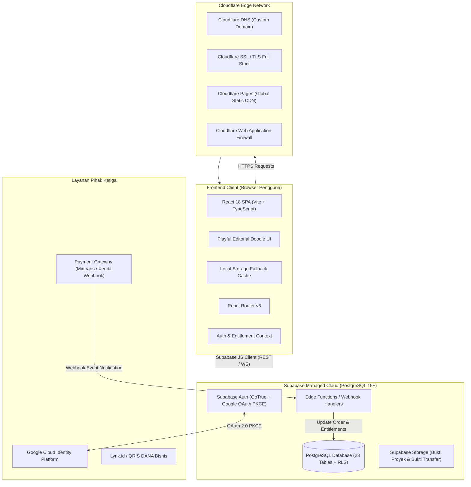
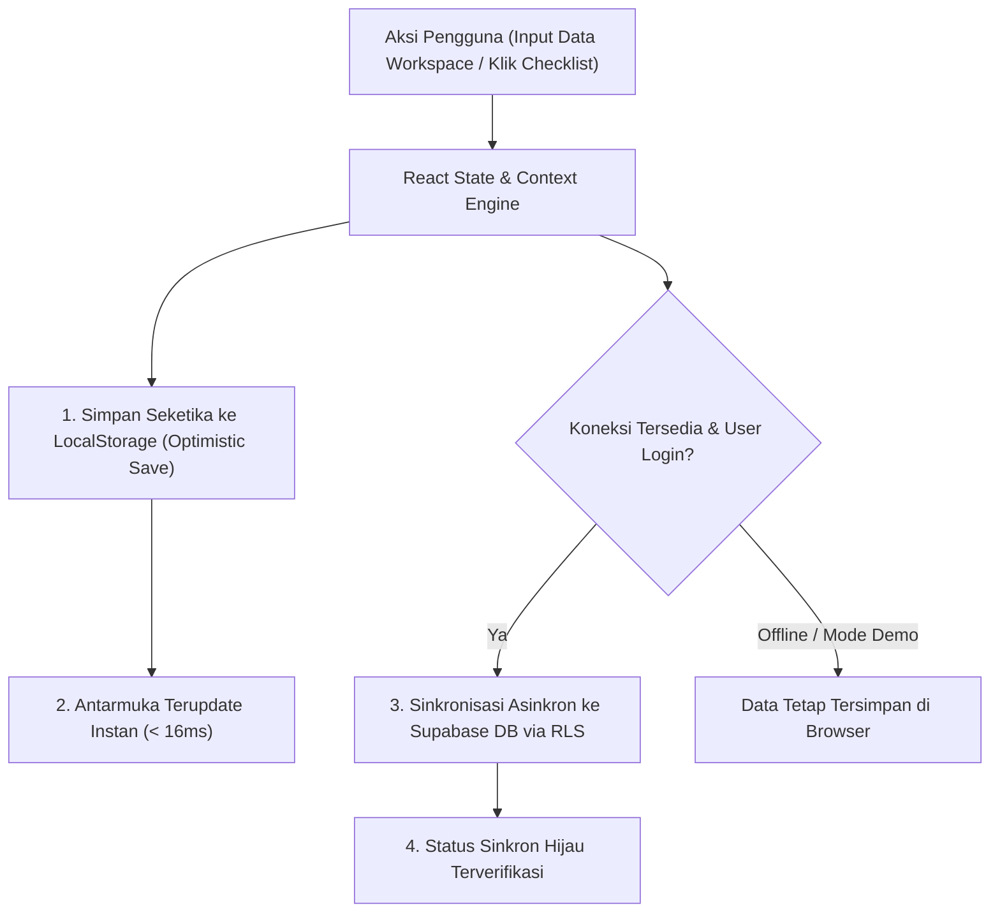
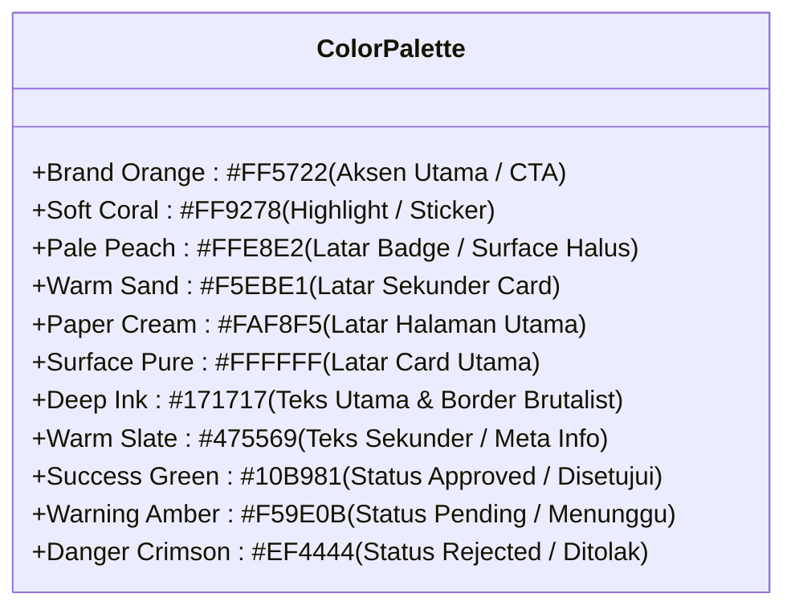
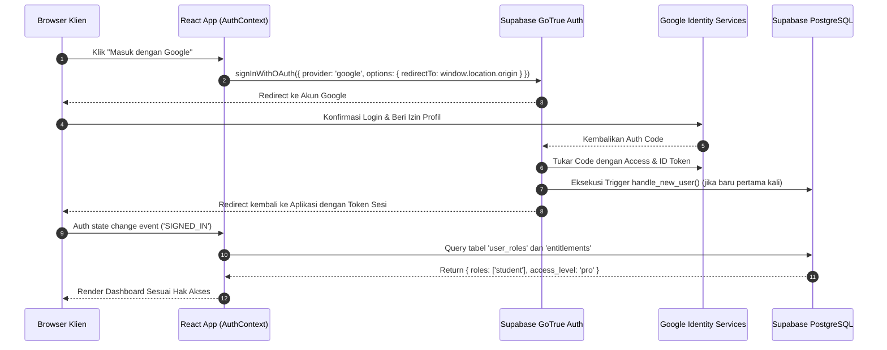

# SYSTEM ARCHITECTURE & TECHNICAL BLUEPRINT
## SHOPEE AFFILIATE ACADEMY PLATFORM

Dokumen ini mendokumentasikan arsitektur sistem, tumpukan teknologi (*technology stack*), topologi infrastruktur, pola desain perangkat lunak (*design patterns*), serta spesifikasi sistem desain visual Shopee Affiliate Academy.

---

## 1. ARSITEKTUR SISTEM GLOBAL

Sistem dibangun menggunakan arsitektur **Single Page Application (SPA) modern berbasis React & TypeScript**, di-hosting di jaringan CDN global **Cloudflare Pages**, terintegrasi dengan **Supabase** sebagai Backend-as-a-Service (BaaS) tingkat produksi.



---

## 2. TUMPUKAN TEKNOLOGI (TECHNOLOGY STACK)

| Layer | Teknologi | Versi | Justifikasi Pemilihan |
| :--- | :--- | :--- | :--- |
| **Framework Frontend** | React | 18.3+ | Komponen modular, ekosistem luas, manajemen state reaktif. |
| **Bahasa Pemrograman** | TypeScript | 5.6+ | Keamanan tipe statis, mengurangi bug runtime, DX superior. |
| **Build Tool & Bundler** | Vite | 6.0+ | Hot Module Replacement (HMR) instan, build bundle cepat. |
| **Styling & CSS** | Tailwind CSS | 3.4+ | Utility-first styling, desain custom fleksibel, zero runtime overhead. |
| **Ikonografi** | Lucide React | 1.16+ | Set ikon modern, konsisten, ringan, dan tree-shakeable. |
| **Markdown Engine** | react-markdown + remark-gfm | Terbaru | Render kurikulum Markdown dengan dukungan tabel, checklist, dan blockquote. |
| **Routing** | React Router DOM | 6.28+ | Client-side routing deklaratif dengan proteksi rute dinamis. |
| **Backend & Database** | Supabase (PostgreSQL) | 15+ | SQL relasional tangguh, Row Level Security (RLS), trigger bawaan. |
| **Autentikasi** | Supabase Auth | Built-in | Mendukung Email/Password dan Google OAuth terstandarisasi. |
| **Hosting & CDN** | Cloudflare Pages | N/A | Latensi ultra-rendah di Indonesia, proteksi DDoS, sertifikat SSL otomatis. |

---

## 3. ARSITEKTUR DUAL-LAYER STORAGE (OFFLINE-FIRST RESILIENCE)

Untuk menjamin kenyamanan pengguna saat mengerjakan workspace panjang atau membaca materi di area dengan koneksi internet fluktuatif, platform mengimplementasikan strategi penyimpanan ganda:



### Modul Penyimpanan Khusus:
1. `workspaceStorage.ts`: Mengelola data lokal dan sinkronisasi awan Supabase untuk produk riset, catatan niche/kompetitor, draft konten studio, kalender konten, arsip tautan afiliasi, catatan performa, eksperimen, dan dokumen SOP.
2. `orderStorage.ts`: Mengelola transaksi lokal, pembuatan nomor invoice unik, dan pemeliharaan status entitlement pengguna secara optimistik.
3. `affiliateStorage.ts`: Mengelola pencatatan klik referral lokal, kalkulasi komisi, dan permohonan payout.

---

## 4. STRUKTUR FOLDER & MODULARITAS KODE

```
shopee-affiliate-academy/
├── public/                     # Aset statis publik (favicon, manifest, robots.txt)
├── docs/                       # Dokumentasi arsitektur, PRD, panduan dev, runbook
│   ├── archive/                # Arsip dokumen terdahulu
│   ├── course/                 # Materi kanonis kurikulum Shopee Affiliate V2 (UNTOUCHED)
│   ├── desain/                 # Ilustrasi dashboard dan ikon sistem
│   ├── PRD.md
│   ├── USER-FLOW.md
│   ├── SYSTEM-ARCHITECTURE.md
│   ├── DATABASE.md
│   ├── AI-SPESIFICATION.md
│   ├── DEVELOPMENT-GUIDE.md
│   ├── SECURITY-CHECKLIST.md
│   ├── TEST-PLAN.md
│   ├── AUDIT-AND-REMEDIATION-LOG.md
│   └── DEPLOYMENT-RUNBOOK.md
├── src/
│   ├── components/             # Komponen antarmuka yang dapat digunakan ulang
│   │   ├── common/             # Logo, Doodles, ScrollToTop
│   │   ├── layout/             # Navbar, Sidebar, BottomNav, Footer, AppLayout
│   │   └── ui/                 # Button, Modal, Card, Badge, Input, Table
│   ├── context/                # Context provider global (Theme, UI state)
│   ├── data/                   # Data statis terstruktur (curriculumData, hookBankData, proPlusBonusData)
│   ├── features/               # Modul logika domain fungsional
│   │   ├── affiliate/          # Logika referral, cookie tracking, komisi
│   │   ├── auth/               # AuthContext, Google OAuth, proteksi rute
│   │   ├── commerce/           # CheckoutModal, manajemen order, invoice
│   │   ├── learning/           # MarkdownRenderer, pelacakan progres belajar
│   │   └── workspaces/         # Adapter penyimpanan 6 workspace
│   ├── hooks/                  # Custom React hooks (usePageTitle, useScroll, useDebounce)
│   ├── lib/                    # Klien eksternal (supabaseClient.ts, utils.ts)
│   ├── pages/                  # Halaman aplikasi
│   │   ├── admin/              # Panel admin (/admin)
│   │   ├── affiliate/          # Dashboard kemitraan (/affiliate/dashboard)
│   │   ├── learning/           # Katalog modul, reader materi, viewer bonus Pro Plus
│   │   ├── legal/              # Syarat ketentuan & kebijakan privasi
│   │   └── workspaces/         # 6 Halaman workspace operasional
│   ├── routes/                 # Konfigurasi router & rute yang dilindungi
│   ├── types/                  # Definisi TypeScript interface (database.ts)
│   ├── App.tsx                 # Root component aplikasi
│   └── main.tsx                # Entry point React DOM
├── supabase/                   # Konfigurasi Supabase lokal & migrasi SQL
│   └── migrations/             # Berkas migrasi skema database terurut
├── tailwind.config.js          # Konfigurasi token warna, font, dan bayangan
└── vite.config.ts              # Konfigurasi bundling Vite & path aliases
```

---

## 5. SISTEM IDENTITAS VISUAL (PLAYFUL EDITORIAL DOODLE SYSTEM)

Identitas visual Shopee Affiliate Academy menggabungkan keseriusan perangkat lunak SaaS modern (*Brutalist structure & high contrast*) dengan kehangatan ilustrasi editorial buatan tangan (*Hand-Drawn Doodles*). Pendekatan ini membuat materi kurikulum yang padat tidak terasa mengintimidasi bagi pemula.

### 5.1 Palet Warna Resmi (Design Tokens)



### 5.2 Tipografi & Hirarki Teks
- **Display & Headings:** `Plus Jakarta Sans` / `Inter`, bobot 800 (Extra Bold) hingga 900 (Black).
- **Body & Editorial Text:** `Inter`, bobot 400 (Regular) dan 500 (Medium), dengan jarak baris longgar (*line-height: 1.65*) untuk kenyamanan membaca artikel panjang.
- **Data & Angka Finansial:** Tabular numbers (`font-mono`) untuk memastikan perataan angka komisi dan statistik performa.

### 5.3 Karakteristik Brutalist Card & Doodle Accents
1. **Solid Ink Border:** Garis tepi tegas hitam pekat (`border-2 border-[#171717]` atau `border-3`).
2. **Hard Drop Shadow:** Bayangan tegas tanpa blur (`shadow-[4px_4px_0px_#171717]` atau `shadow-[6px_6px_0px_#FF5722]`).
3. **Hand-Drawn Doodle System:** Komponen SVG khusus (`Doodles.tsx`: Sparkles, Underlines, Arrows, Sticky Badges, Starbursts) untuk menekankan poin kunci, tips rahasia, atau peringatan penting.

---

## 6. INTEGRASI AUTENTIKASI (SUPABASE AUTH + GOOGLE OAUTH)



---

## 7. SISTEM PEMROSESAN PEMBAYARAN & ENTITLEMENT ENGINE

1. **Order Creation:** Saat pengguna membuka checkout, sistem menerbitkan order baru dengan nomor acak unik berformat `SAA-YYYYMMDD-XXXXX`.
2. **Payment Channel Routing:**
   - **Lynk.id:** Pengguna diarahkan ke tautan pembayaran resmi dengan parameter email pembeli.
   - **QRIS DANA Bisnis:** Pengguna memindai kode QRIS dinamis/statis berizin resmi.
   - **Payment Gateway Webhook:** Menerima notifikasi HTTP POST terotentikasi, memvalidasi signature SHA-256, lalu mengubah status order menjadi `paid`.
3. **Entitlement State Transition:**
   - Status order `paid` memicu aktivasi baris pada tabel `entitlements` dengan `access_level` yang sesuai (`pro` atau `pro_plus`).
   - Apabila terdapat referral code yang tersimpan pada cookie pengunjung, sistem mencatat komisi 10% ke dalam tabel `referral_conversions`.

---

## 8. STRATEGI CACHING, DEPLOYMENT & EDGE TOPOLOGY

1. **Build Output:** Hasil build Vite ditempatkan pada direktori `dist/` dengan nama file ber-hash konten (*content-hashed filenames*) untuk mendukung *immutable asset caching* (Cache-Control: `public, max-age=31536000, immutable`).
2. **HTML Entry File:** `index.html` disajikan dengan header `Cache-Control: public, max-age=0, must-revalidate` untuk menjamin rilis versi baru langsung diterima pengguna tanpa perlu hard-refresh paksa.
3. **Single Page Routing Fallback:** Konfigurasi Cloudflare Pages mengarahkan seluruh rute 404 ke `index.html` (`/* -> /index.html 200`) agar routing sisi klien berjalan mulus.
