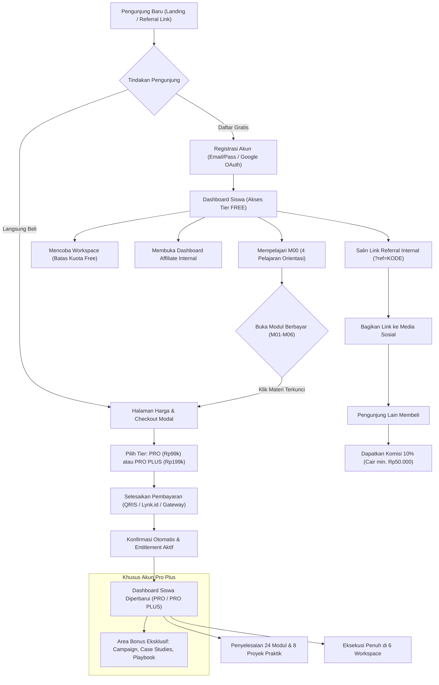
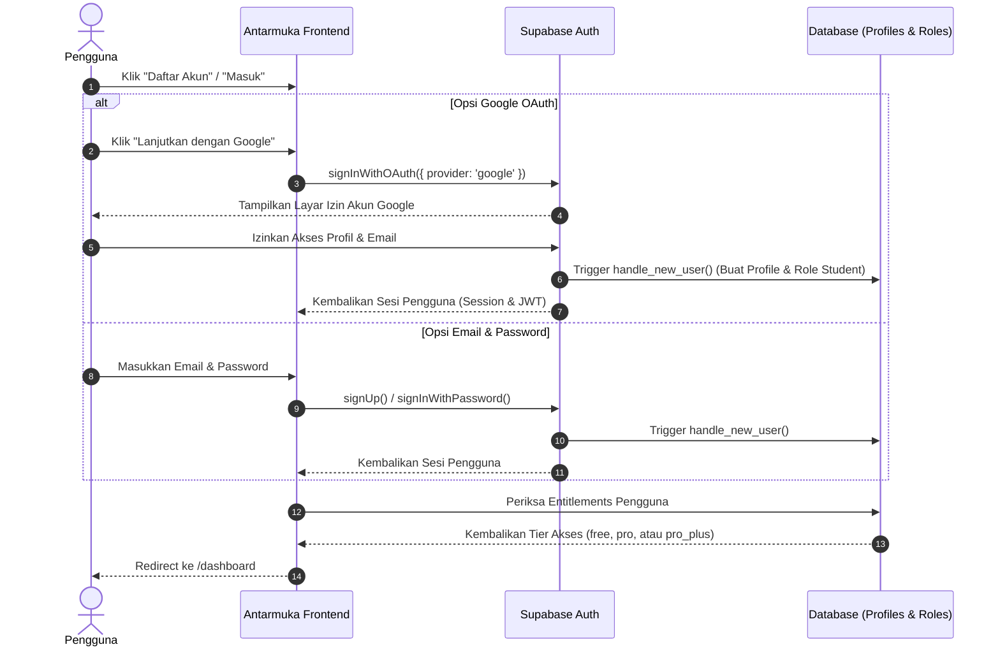
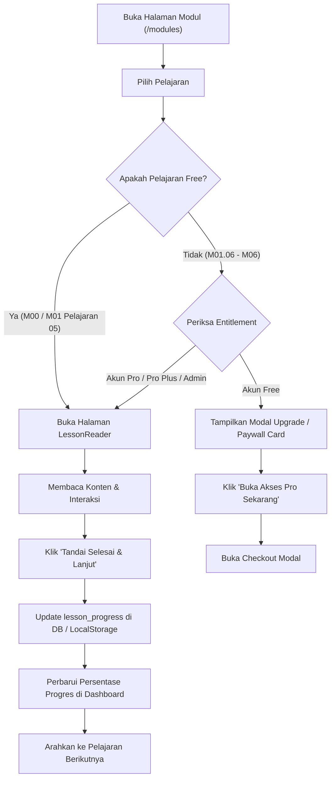
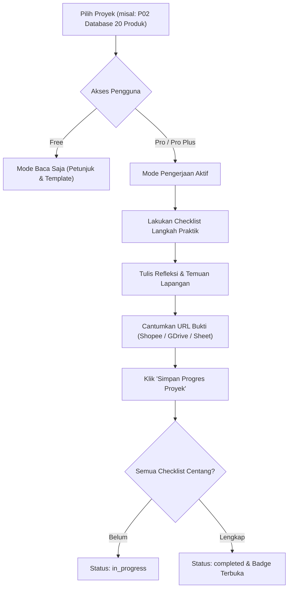
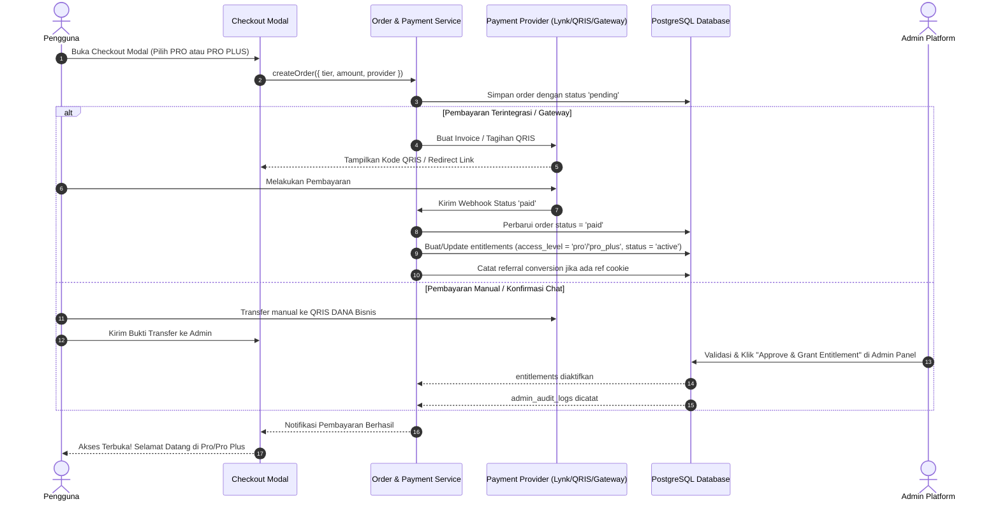
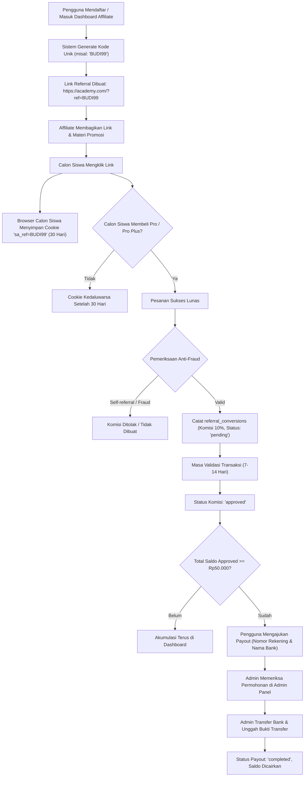
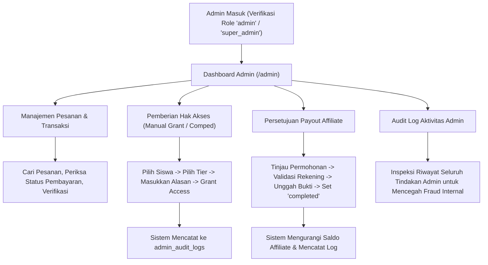

# USER FLOW & JOURNEY SPECIFICATION
## SHOPEE AFFILIATE ACADEMY PLATFORM

Dokumen ini memetakan seluruh perjalanan pengguna (*user journeys*), diagram alir (*flowcharts*), serta mesin status (*state machines*) di dalam aplikasi Shopee Affiliate Academy.

---

## 1. PETA PERJALANAN PENGGUNA (HIGH-LEVEL USER JOURNEY)

---

## 2. ALUR AUTENTIKASI & ONBOARDING

### 2.1 Pendaftaran & Masuk (Email & Google OAuth)

### 2.2 Aturan State Autentikasi
1. Jika pengguna belum login dan mengakses rute publik (`/`, `/modules`, `/pricing`, `/terms`, `/privacy`), halaman dapat diakses langsung.
2. Jika pengguna belum login dan mengakses rute privat (`/dashboard`, `/projects/*`, `/workspaces/*`, `/affiliate/dashboard`), pengguna diarahkan ke `/login` dengan menyimpan rute tujuan (*redirect query parameter*).
3. Saat registrasi berhasil, akun secara otomatis memperoleh `role = 'student'` dan `access_level = 'free'`.

---

## 3. ALUR BELAJAR & PENYELESAIAN PROYEK (LMS FLOW)

### 3.1 Navigasi Modul & Kontrol Akses (Paywall Gate)

### 3.2 Alur Proyek Praktik Wajib (P01–P08)

---

## 4. ALUR ENAM WORKSPACE OPERASIONAL

Setiap workspace dirancang untuk saling terhubung dalam siklus kerja harian affiliate:

```mermaid
flowchart LR
    subgraph W1["1. Riset Produk"]
        A["Product Research Lab"] -->|"Skor 7 Faktor & Status Ready"| B["Koleksi Produk Pilihan"]
    end
    
    subgraph W2["2. Riset Niche & Kompetitor"]
        C["Research Notes"] -->|"Catat Celah Konten"| B
    end
    
    subgraph W3["3. Kreasi Naskah Konten"]
        B --> D["Content Creation Studio"]
        E["Hook Bank"] --> D
        D -->|"Draft Naskah & Tautan Link"| F["Content Items"]
    end
    
    subgraph W4["4. Perencanaan & QC"]
        F --> G["Content Planner"]
        G -->|"Jadwal & 11-QC Checklist"| H["Status: Terbit"]
    end
    
    subgraph W5["5. Tracking Komisi & Metrik"]
        H --> I["Performance Tracker"]
        I -->|"Catat Klik, Pesanan, Komisi"| J["Analisis CVR & EPC"]
    end
    
    subgraph W6["6. Eksperimen Saintifik"]
        J -->|"Identifikasi Masalah"| K["Experiment Tracker"]
        K -->|"Uji 1 Variabel (14 Hari)"| L["Keputusan: Skala / Stop"]
        L -->|"Update Pola Kerja"| M["SOP Documents"]
    end
```

### Detail Interaksi Workspace:
1. **Product Research Lab:** Pengguna memasukkan data produk Shopee, memberikan skor 1-5 pada 7 faktor penilaian. Sistem mengkalkulasi skor komposit numerik dan menyarankan status (*Research, Ready, Testing, Dropped*).
2. **Content Studio:** Menarik produk dari *Product Research Lab*, memilih formula hook dari *Hook Bank*, menyusun naskah dan CTA, lalu menyimpan draft item konten.
3. **Content Planner:** Mengatur tanggal publikasi, memvalidasi 11 butir Quality Control sebelum unggah, dan menandai konten terbit.
4. **Performance Tracker:** Menginput data berkala dari laporan performa Shopee untuk menghitung rasio konversi dan memantau status komisi valid.
5. **Experiment Tracker:** Menjalankan eksperimen terisolasi (misal: pengujian durasi video, perubahan format hook) dengan baseline dan hasil terukur.

---

## 5. ALUR CHECKOUT, PEMBAYARAN & AKTIVASI ENTITLEMENT

---

## 6. ALUR PROGRAM AFFILIATE INTERNAL & PENCAIRAN KOMISI

---

## 7. ALUR MANAJEMEN PANEL ADMIN

---

## 8. MATRIX PENANGANAN ERROR & RECOVERY FLOW

| Skenario Error | Penanganan Sistem | Aksi Pengguna |
| :--- | :--- | :--- |
| **Koneksi Internet Putus Saat Mengisi Workspace** | Data disimpan seketika di peramban via `localStorage` (Optimistic UI). Notifikasi "Menyimpan di perangkat". | Tetap bekerja tanpa takut data hilang; data akan disinkronkan saat terhubung kembali. |
| **Gagal Login dengan Google** | Tangkap error callback Supabase, tampilkan toast pesan jelas (misal: popup diblokir / izin ditolak). | Coba kembali atau gunakan opsi login email & password. |
| **Pembayaran Tertunda / Pending Timeout** | Status order tetap `pending`. Batas waktu pembayaran 24 jam. | Tampilkan nomor invoice dan tombol "Cek Status Pembayaran" atau hubungi admin. |
| **Upaya Self-Referral Terdeteksi** | Sistem memeriksa kecocokan `user_id` pembeli dengan `affiliate_id` rujukan. Jika identik, referral diabaikan. | Pembelian tetap diproses normal, namun tidak ada komisi yang dihasilkan untuk akun sendiri. |
