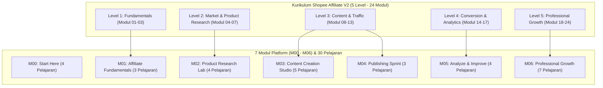
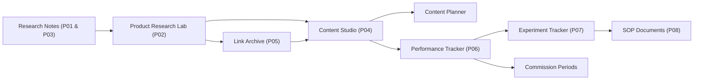

# MASTER DEVELOPMENT DOCUMENT — SHOPEE AFFILIATE ACADEMY (v2.0 FINAL)
> **Status:** Dokumen Tunggal Resmi & Konsolidasi Final (Production-Ready). Mengintegrasikan Master v1.2, Addendum v1.3 (Free-to-Premium & Visual Identity), Addendum Program Affiliate Internal v1.5, dan Scope Lock v1.4.  
> **Target:** Platform Pembelajaran, Workspace Eksekusi, dan Ekosistem Affiliate Lengkap — **Siap Dipublikasikan (Bukan sekadar MVP setengah jadi)**.  
> **Kesesuaian Kurikulum:** 100% Selaras dengan Kurikulum Shopee Affiliate V2 (5 Level, 24 Modul Materi, 8 Project Praktik Wajib, 6 Database Kerja, Lembar Rumus & Template).

---

## DAFTAR ISI
1. [Arsitektur Produk & Visi Bisnis](#1-arsitektur-produk--visi-bisnis)
2. [Kesesuaian Kurikulum & Materi Course](#2-kesesuaian-kurikulum--materi-course)
3. [Model Akses Free-to-Premium & Monetisasi](#3-model-akses-free-to-premium--monetisasi)
4. [Program Affiliate Internal & Dashboard Affiliate](#4-program-affiliate-internal--dashboard-affiliate)
5. [Enam Workspace Kerja Terpadu](#5-enam-workspace-kerja-terpadu)
6. [Arsitektur Teknis & Database Schema (PostgreSQL via Supabase)](#6-arsitektur-teknis--database-schema-postgresql-via-supabase)
7. [Identitas Visual (Playful Editorial Doodle System) & UI/UX](#7-identitas-visual-playful-editorial-doodle-system--uiux)
8. [Struktur Routing & Peta Halaman](#8-struktur-routing--peta-halaman)
9. [Sistem Transaksi, Entitlement, dan Anti-Fraud](#9-sistem-transaksi-entitlement-dan-anti-fraud)
10. [Keamanan Data & Perlindungan Konten Privat](#10-keamanan-data--perlindungan-konten-privat)
11. [Roadmap Pengembangan 8 Fase (Target Siap Publikasi)](#11-roadmap-pengembangan-8-fase-target-siap-publikasi)
12. [Matriks Keselarasan Materi vs Fitur Platform](#12-matriks-keselarasan-materi-vs-fitur-platform)
13. [Kriteria Kelulusan Akhir & Checklist Publikasi](#13-kriteria-kelulusan-akhir--checklist-publikasi)

---

# 1. ARSITEKTUR PRODUK & VISI BISNIS

### 1.1 Visi Produk
**Shopee Affiliate Academy** adalah platform berbasis web edukatif sekaligus ruang kerja operasional (workspace) terpadu untuk pelaku Shopee Affiliate di Indonesia. Platform ini dirancang untuk mengubah pola pikir pemula dari sekadar "penebar link acak" menjadi pebisnis affiliate profesional yang bekerja dengan data, riset tervalidasi, sistem konten terencana, dan evaluasi metrik terukur.

Nilai pembeda utama produk ini bertumpu pada 4 pilar yang tidak terpisahkan:
1. **Structured Learning System:** Kurikulum 5 level dari dasar operasional hingga scaling lanjutan.
2. **Integrated Execution Workspaces:** 6 workspace digital terintegrasi yang menggantikan kebutuhan template Notion eksternal yang rumit.
3. **Evidence-Based Practice Projects:** 8 proyek praktik wajib yang mewajibkan input data dan analisis nyata, bukan sekadar kuis teori.
4. **Built-in Growth & Internal Affiliate:** Sistem kemitraan terintegrasi di mana pengguna (Free maupun Premium) dapat mempromosikan platform ini dan mendapatkan bagi hasil komisi transparan.

### 1.2 Ringkasan Parameter Bisnis & Teknologi
| Parameter | Spesifikasi Resmi |
| :--- | :--- |
| **Produk** | Shopee Affiliate Academy Platform Web |
| **Target Pasar** | Pemula hingga praktisi Shopee Affiliate di Indonesia |
| **Model Akses** | **Freemium:** Akses Terbuka (Free) + Akses Penuh (Premium Sekali Bayar) |
| **Harga Peluncuran** | **Rp99.000** (Sekali bayar, kuota 100 pembeli pertama / promo peluncuran 14 hari) |
| **Harga Reguler** | **Rp149.000** (Sekali bayar, akses jangka panjang selama layanan beroperasi) |
| **Program Affiliate Internal** | Komisi **10%** dari transaksi bersih, Cookie atribusi 30 hari, Minimal payout Rp50.000 |
| **Kanal Penjualan Awal** | Lynk.id / QRIS DANA Bisnis terverifikasi / Integrasi Payment Gateway aman |
| **Frontend Stack** | React 18+, TypeScript, Vite, Tailwind CSS, shadcn/ui |
| **Backend & Database** | Supabase (PostgreSQL 15+, Supabase Auth, Row Level Security, Storage/Edge Functions) |
| **Hosting Frontend** | Cloudflare Pages (Custom Domain dengan HTTPS, WAF & CDN global) |
| **Gaya Desain** | *Playful Editorial × Hand-Drawn Doodle System × Modern SaaS* |

### 1.3 Lima Aturan Emas Produk & Pemasaran
1. **Aturan Resmi Selalu Diutamakan:** Menegakkan kepatuhan mutlak pada aturan Shopee Affiliate Program resmi.
2. **Jujur, Orisinal, & Transparan:** Wajib disclosure affiliate pada konten promosi; melarang klaim produk palsu atau review tanpa pernah memegang produk.
3. **Data Sebelum Keputusan:** Mengharamkan spekulasi; evaluasi performa selalu bersandar pada metrik CTR, CVR, EPC, dan 4 status komisi.
4. **Satu Hal Sekaligus:** Mengarahkan pengguna fokus pada 1 channel organik utama dan 1 variabel per eksperimen.
5. **Anti-Klaim Palsu:** Platform dan seluruh halaman penjualan **dilarang keras** menjanjikan "pasti cuan", "garansi omzet puluhan juta", atau klaim penghasilan pasif instan. Semua angka simulasi di platform ditegaskan sebagai bahan latihan numerik.

---

# 2. KESESUAIAN KURIKULUM & MATERI COURSE

Kurikulum di dalam platform diselaraskan secara penuh dengan materi kanonis **Shopee Affiliate V2**:



### 2.1 Pemetaan Modul Platform (M00–M06) & 30 Pelajaran
Di antarmuka aplikasi, pengguna melihat modul platform sebagai **"Tahap Pembelajaran"** dan pelajaran dengan nama aslinya untuk menjaga kejelasan:

*   **M00 — Start Here (Pengantar & Orientasi) — 4 Pelajaran (Akses FREE):**
    1. *Pelajaran 01:* Selamat Datang dan Cara Belajar di Affiliate Academy.
    2. *Pelajaran 02:* Peta Belajar dan 5 Aturan Emas Shopee Affiliate.
    3. *Pelajaran 03:* Kamus Istilah Baku (Status Komisi, Funnel, Metrik Kunci).
    4. *Pelajaran 04:* Panduan Menjalankan 6 Workspace Praktik & Sprint Awal 14 Hari.
*   **M01 — Affiliate Fundamentals (Level 1) — 3 Pelajaran (Modul 01 Preview FREE; Modul 02–03 PREMIUM):**
    1. *Pelajaran 05 (Modul 01):* Dasar Affiliate Marketing & Model Bisnis. *(Free Preview)*
    2. *Pelajaran 06 (Modul 02):* Shopee Affiliate Program, Kebijakan, dan Aturan Komisi. *(Premium)*
    3. *Pelajaran 07 (Modul 03):* Persiapan Akun, Keamanan, Operasional, dan Pajak. *(Premium)*
*   **M02 — Product Research Lab (Level 2) — 4 Pelajaran (PREMIUM):**
    1. *Pelajaran 08 (Modul 04):* Riset Pasar dan Permintaan Konsumen.
    2. *Pelajaran 09 (Modul 05):* Niche, Audiens, dan Brand Positioning.
    3. *Pelajaran 10 (Modul 06):* Riset dan Evaluasi Produk dengan Skor 7 Faktor.
    4. *Pelajaran 11 (Modul 07):* Riset Kompetitor dan Analisis Celah Konten.
*   **M03 — Content Creation Studio (Level 3 Bagian 1) — 5 Pelajaran (PREMIUM):**
    1. *Pelajaran 12 (Modul 08):* Strategi Channel dan Traffic Organik.
    2. *Pelajaran 13 (Modul 09):* Strategi Konten dan Pilar Edukasi-Solusi.
    3. *Pelajaran 14 (Modul 10):* Copywriting, Hook Bank, dan Formula CTA.
    4. *Pelajaran 15 (Modul 11):* Produksi Video Pendek dan Visual Orisinal.
    5. *Pelajaran 16 (Modul 12):* SEO Konten dan Pencarian Shopee/Media Sosial.
*   **M04 — Publishing Sprint (Level 3 Bagian 2) — 3 Pelajaran (PREMIUM):**
    1. *Pelajaran 17 (Modul 13):* Distribusi Konten dan Community Building.
    2. *Pelajaran 18 (Proyek Akhir Level 3):* Rencana Publikasi 30 Hari (Sprint Awal Hari 1–14).
    3. *Pelajaran 19 (Checklist QC):* 11 Butir Quality Control Sebelum Konten Terbit.
*   **M05 — Analyze & Improve (Level 4) — 4 Pelajaran (PREMIUM):**
    1. *Pelajaran 20 (Modul 14):* Affiliate Link, Deep-Linking, dan Tracking Tagging.
    2. *Pelajaran 21 (Modul 15):* Conversion Rate Optimization (CRO) & Funnel Analysis.
    3. *Pelajaran 22 (Modul 16):* Analytics Dashboard dan Metrik Kinerja.
    4. *Pelajaran 23 (Modul 17):* Eksperimen Terstruktur dan Validasi Hipotesis.
*   **M06 — Professional Growth (Level 5) — 7 Pelajaran (PREMIUM):**
    1. *Pelajaran 24 (Modul 18):* Monetisasi Lanjutan dan Pemilihan Produk Evergreen.
    2. *Pelajaran 25 (Modul 19):* Manajemen Keuangan, Target Komisi, dan Alokasi Biaya.
    3. *Pelajaran 26 (Modul 20):* Scaling Bisnis dan Sistem Batch Production.
    4. *Pelajaran 27 (Modul 21):* Kepatuhan Ketat, Manajemen Risiko, dan Reputasi.
    5. *Pelajaran 28 (Modul 22):* Advanced Strategy & Diversifikasi Multi-Platform.
    6. *Pelajaran 29 (Modul 23):* Otomasi Alur Kerja dan Mendelegasikan Tugas.
    7. *Pelajaran 30 (Modul 24):* Evaluasi Bisnis Menyeluruh dan Affiliate Mastery.

### 2.2 Standardisasi 8 Proyek Praktik Wajib
Platform menyediakan halaman khusus untuk setiap proyek praktik dengan integrasi ke database pengguna:
1. **P01 — Niche Research:** Identifikasi niche, profil audiens, dan 10 masalah nyata audiens dengan bukti sumber (terhubung ke *Research Notes*).
2. **P02 — Product Research:** Seleksi 3–5 produk unggulan menggunakan evaluasi bobot 7 faktor (terhubung ke *Product Research Lab*).
3. **P03 — Competitor Research:** Pemetaan 5–10 akun kompetitor dan identifikasi 10 celah konten pembeda (terhubung ke *Research Notes*).
4. **P04 — Content Production:** Pembuatan 30 ide konten, 10 naskah lengkap, dan minimal 10 konten terbit (terhubung ke *Content Studio* & *Planner*).
5. **P05 — First Conversion:** Pemasangan link affiliate terverifikasi dan diagnosis alur funnel (terhubung ke *Link Archive* & *Performance Tracker*).
6. **P06 — Analytics Dashboard:** Penyusunan dashboard mingguan dan evaluasi metrik CTR, CVR, EPC (terhubung ke *Tracker* & *Commission Periods*).
7. **P07 — Optimization Sprint:** Eksekusi 1 eksperimen perbaikan terstruktur dengan hipotesis 4 bagian (terhubung ke *Experiment Tracker*).
8. **P08 — Business Growth Plan:** Penyusunan target numerik komisi, kalkulasi kebutuhan traffic, dan SOP produksi (terhubung ke *Commission Periods* & *SOP Document Hub*).

### 2.3 Standar Rumus dan Istilah Baku Aplikasi
Setiap metrik yang dihitung di dalam aplikasi wajib mengacu pada rumus standar:
*   **CTR (Click-Through Rate):** $\frac{\text{Klik}}{\text{Views}} \times 100\%$ (ditampilkan terhadap total tayangan).
*   **CVR (Conversion Rate):** $\frac{\text{Pesanan}}{\text{Klik}} \times 100\%$.
*   **CVR Valid:** $\frac{\text{Pesanan Memenuhi Syarat}}{\text{Klik}} \times 100\%$.
*   **EPC (Earnings Per Click):** $\frac{\text{Komisi Disetujui}}{\text{Klik}}$.
*   **Komisi per 1.000 Views (RPM):** $\frac{\text{Komisi Disetujui}}{\text{Views}} \times 1.000$.
*   **Rasio Pembatalan:** $\frac{\text{Pesanan Dibatalkan}}{\text{Total Pesanan}} \times 100\%$.
*   **Empat Status Komisi (TIDAK BOLEH DIJUMLAHKAN):**
    1. *Estimasi:* Transaksi baru tercatat di dashboard Shopee.
    2. *Pending:* Menunggu konfirmasi penerimaan barang dan periode bebas retur.
    3. *Disetujui:* Pesanan tervalidasi dan siap dibayarkan.
    4. *Dibayarkan:* Dana komisi telah ditransfer ke rekening bank pengguna.

---

# 3. MODEL AKSES FREE-TO-PREMIUM & MONETISASI

### 3.1 Perbandingan Tingkatan Akun
Platform mengadopsi model **Freemium Terstruktur**:

| Fitur / Modul | Akun Free (Rp0) | Akun Premium (Rp99k Promo / Rp149k Reguler) |
| :--- | :---: | :---: |
| **Registrasi & Login Akun** | Ya | Ya |
| **Akses Pelajaran M00 (4 Pelajaran)** | Ya (Lengkap) | Ya (Lengkap) |
| **Preview Modul 01 (Dasar Affiliate)** | Ya (Preview Penuh) | Ya (Lengkap) |
| **Akses Modul 02 s.d. Modul 24** | Terkunci (Hanya Ringkasan & CTA) | Ya (Akses Penuh Selamanya) |
| **Dashboard Progres Belajar** | Ya (Hanya materi Free) | Ya (Seluruh materi & metrik) |
| **8 Proyek Praktik Wajib** | Preview Tugas (Read-Only) | Akses Penuh, Simpan Progres & Bukti |
| **Product Research Lab** | Terbatas (Maksimal 3 Produk) | Tanpa Batas (Unlimited) |
| **Content Creation Studio** | Terbatas (Maksimal 3 Draf) | Tanpa Batas + Template Hook Bank |
| **Content Planner (Kalender 30 Hari)** | Read-Only Template | Kalender Interaktif Penuh |
| **Performance Tracker & Eksperimen** | Terbatas (Maksimal 5 Baris Data) | Tanpa Batas + Analisis Formula Otomatis |
| **Link Archive & SOP Documents** | Terkunci | Akses Penuh |
| **Hak Menjadi Affiliate Platform** | **Ya (Bisa Hasilkan Komisi 10%)** | **Ya (Bisa Hasilkan Komisi 10%)** |

### 3.2 Paywall & User Experience Materi Terkunci
Ketika pengguna berstatus Free membuka pelajaran premium (Modul 02 ke atas):
1. Sistem menampilkan banner editorial: *"Materi Ini Khusus Anggota Premium Affiliate Academy"*.
2. Judul modul, tujuan pembelajaran, dan ringkasan 2 paragraf tetap ditampilkan sebagai cuplikan edukatif.
3. Konten inti Markdown disembunyikan di backend (tidak dikirim ke browser).
4. Kartu penawaran menampilkan benefit paket Premium, garansi materi update, testimoni/studi kasus, dan tombol **"Buka Akses Premium Sekarang — Hanya Rp99.000"**.

---

# 4. PROGRAM AFFILIATE INTERNAL & DASHBOARD AFFILIATE

Shopee Affiliate Academy memiliki program kemitraan affiliate internal bawaan (built-in). Pengguna (baik Free maupun Premium) dapat mereferensikan platform ini kepada calon pembelajar lainnya dan memperoleh komisi atas setiap transaksi yang berhasil diverifikasi.

### 4.1 Aturan Program Affiliate Internal
*   **Kelayakan Affiliate:** Seluruh pengguna terdaftar (Free dan Premium) dapat langsung mengaktifkan status affiliate tanpa biaya tambahan.
*   **Besaran Komisi:** **10% flat** dari nilai transaksi bersih yang dibayarkan pembeli (setelah potongan diskon/voucher). Contoh: Pembelian Rp99.000 menghasilkan komisi Rp9.900 per transaksi; pembelian Rp149.000 menghasilkan komisi Rp14.900.
*   **Mekanisme Pelacakan:**
    *   Parameter URL unik: `https://domain-akademi.com/?ref=KODEREFERRAL`.
    *   Cookie atribusi bertahan selama **30 hari** berbasis *Last-Click Attribution*.
    *   Pengunjung yang mendaftar atau membeli dalam jendela 30 hari diatribusikan ke affiliate terkait.
*   **Batas Minimum Pencairan (Payout):** **Rp50.000**.
*   **Metode Pencairan:** Transfer Bank Domestik (BCA, Mandiri, BRI, BNI) dan E-Wallet resmi (GoPay, OVO, DANA).
*   **Validasi & Anti-Fraud:**
    *   *Self-Referral Prohibition:* Affiliate dilarang keras membeli kursus menggunakan link referral miliknya sendiri (sistem memvalidasi ID akun, email, dan rekening bank).
    *   Pencairan diproses secara manual oleh Admin melalui approval dashboard untuk memastikan tidak ada transaksi refund atau fraudulent clicks.

### 4.2 Struktur Menu Dashboard Affiliate Pengguna
Pengguna yang mengaktifkan fitur affiliate memiliki akses ke navigasi `/affiliate` dengan 7 sub-menu:
1. **Ringkasan (Dashboard):** Kartu metrik total klik, pesanan teratribusi, rasio konversi, komisi pending, komisi disetujui, saldo siap cair, grafik tren 30 hari, serta tautan referral utama dengan tombol *One-Click Copy*.
2. **Link Referral:** Generator deep-link kustom (misal: mengarahkan langsung ke halaman checkout atau landing page tertentu dengan tag kustom).
3. **Materi Promosi:** Repositori banner grafis, cuplikan salinan copywriting (swipe copy WhatsApp/Instagram/Telegram), dan video mockup resmi yang siap pakai.
4. **Penjualan & Komisi:** Tabel rincian setiap transaksi yang masuk (tanggal, nominal transaksi, komisi didapat, dan status validasi).
5. **Pencairan Komisi:** Formulir pengajuan penarikan saldo (tersedia jika saldo $\ge$ Rp50.000) dan daftar rekening penerima.
6. **Riwayat Transaksi:** Riwayat transfer komisi yang telah dibayarkan oleh admin beserta nomor referensi bank.
7. **Panduan & Kode Etik:** Peraturan resmi promosi (larangan spamming massal, larangan misleading ads).

---

# 5. ENAM WORKSPACE KERJA TERPADU

Platform meniadakan ketergantungan pada Notion eksternal dengan menyediakan 6 ruang kerja web interaktif yang saling terintegrasi:



### 5.1 Rincian Fitur & Relasi Antar-Workspace
1. **Product Research Lab (`/tools/products`):**
   *   Mencatat kandidat produk Shopee: URL, harga, estimasi komisi, rating toko, dan catatan stok.
   *   Kalkulator skor berbobot otomatis (0–100) berbasis 7 faktor: Audiens (25%), Kualitas (20%), Nilai Harga (15%), Besaran Komisi (15%), Tingkat Persaingan (10%), Kemudahan Demonstrasi (10%), Ketersediaan Produk (5%).
   *   Status produk: *Riset*, *Siap Dipromosikan*, *Diuji*, *Dihentikan*.
2. **Research Notes (`/tools/research-notes`):**
   *   Pusat catatan riset niche audiens (Project 01) dan riset kompetitor (Project 03).
   *   Memisahkan antara fakta teramati (bukti URL) dengan asumsi hipotesis serta catatan celah konten yang belum digarap kompetitor.
3. **Content Creation Studio (`/tools/content`):**
   *   Menyusun ide konten yang terhubung langsung ke produk dari *Product Research Lab*.
   *   Pilihan Hook Bank bawaan (30+ hook teruji dalam 5 kategori: Masalah, Penasaran, Demonstrasi, Komparasi, Solusi Keberatan).
   *   Template naskah video terstruktur (Hook $\rightarrow$ Konteks $\rightarrow$ Isi Bukti $\rightarrow$ CTA $\rightarrow$ Disclosure).
   *   Checklist QC 11 butir sebelum produksi konten disetujui.
4. **Content Planner (`/tools/planner`):**
   *   Tampilan kalender dan daftar kerja mingguan/bulanan.
   *   Template bawaan *Sprint Awal 14 Hari* dan *Jadwal Publikasi 30 Hari*.
   *   9 Tahapan status konten: *Ide, Riset, Skrip, Produksi, Pemeriksaan, Siap Publikasi, Terbit, Evaluasi, Selesai*.
5. **Link Archive (`/tools/links`):**
   *   Manajemen tautan Shopee Affiliate (Shortlink & Universal Link) yang dikelompokkan per produk dan platform.
   *   Status tautan: *Aktif*, *Perlu Diperiksa* (jika produk habis/toko nonaktif), *Diarsipkan*. Menghindarkan promosi tautan mati.
6. **Performance Tracker & Experiments (`/tools/tracker` & `/tools/experiments`):**
   *   *Tab Performa:* Input metrik harian per konten (Views, Klik, Pesanan, Pembatalan, dan 4 status komisi). Menghitung otomatis CTR, CVR, EPC, RPM.
   *   *Tab Rekap Periode (`commission_periods`):* Rekonsiliasi keuangan mingguan/bulanan antara pencatatan internal dengan invoice/dashboard Shopee resmi, memperhitungkan jam kerja dan biaya operasional.
   *   *Tab Eksperimen:* Form pengujian A/B dengan format 4 hipotesis: Perubahan yang diuji, Alasan, Tolok ukur metrik, Kriteria keputusan (*Lanjutkan, Optimalkan, Uji Ulang, Kurangi Prioritas, Hentikan*).
7. **SOP & Knowledge Hub (`/tools/sop`):**
   *   Menyimpan dokumen prosedur operasional standar personal/tim (SOP Riset, SOP Syuting, SOP Evaluasi) untuk mendukung kelulusan Project 08.

---

# 6. ARSITEKTUR TEKNIS & DATABASE SCHEMA (POSTGRESQL VIA SUPABASE)

Sistem database dirancang secara ketat menggunakan PostgreSQL di Supabase dengan integritas relasional, foreign key, constraint unik, serta Row Level Security (RLS) di seluruh tabel.

### 6.1 Ringkasan 23 Tabel Database
```
1. profiles                  13. research_notes
2. user_roles                14. affiliate_links
3. modules                   15. experiments
4. lessons                   16. sop_documents
5. lesson_progress           17. orders
6. practice_projects         18. entitlements
7. project_progress          19. admin_audit_logs
8. affiliate_products        20. affiliate_profiles
9. content_templates         21. referral_clicks
10. content_items            22. referral_conversions
11. performance_records      23. affiliate_payouts
12. commission_periods       (marketing_materials)
```

### 6.2 DDL Spesifikasi Skema Database Lengkap
```sql
-- 1. PROFILES & ROLES
CREATE TABLE public.profiles (
    id UUID PRIMARY KEY REFERENCES auth.users(id) ON DELETE CASCADE,
    display_name TEXT NOT NULL,
    avatar_url TEXT,
    phone_number TEXT,
    created_at TIMESTAMPTZ DEFAULT TIMEZONE('utc'::text, NOW()) NOT NULL,
    updated_at TIMESTAMPTZ DEFAULT TIMEZONE('utc'::text, NOW()) NOT NULL
);

CREATE TYPE user_role_enum AS ENUM ('student', 'admin', 'super_admin');
CREATE TABLE public.user_roles (
    id UUID PRIMARY KEY DEFAULT gen_random_uuid(),
    user_id UUID NOT NULL REFERENCES public.profiles(id) ON DELETE CASCADE,
    role user_role_enum DEFAULT 'student' NOT NULL,
    created_at TIMESTAMPTZ DEFAULT TIMEZONE('utc'::text, NOW()) NOT NULL,
    UNIQUE (user_id, role)
);

-- Fungsi Keamanan Admin
CREATE OR REPLACE FUNCTION public.is_admin()
RETURNS BOOLEAN AS $$
BEGIN
  RETURN EXISTS (
    SELECT 1 FROM public.user_roles
    WHERE user_id = auth.uid() AND role IN ('admin', 'super_admin')
  );
END;
$$ LANGUAGE plpgsql SECURITY DEFINER;

-- 2. KURIKULUM & LMS
CREATE TABLE public.modules (
    id UUID PRIMARY KEY DEFAULT gen_random_uuid(),
    code TEXT NOT NULL UNIQUE, -- 'M00' sampai 'M06'
    title TEXT NOT NULL,
    slug TEXT NOT NULL UNIQUE,
    description TEXT,
    sort_order INT NOT NULL DEFAULT 0,
    is_published BOOLEAN DEFAULT true NOT NULL
);

CREATE TABLE public.lessons (
    id UUID PRIMARY KEY DEFAULT gen_random_uuid(),
    module_id UUID NOT NULL REFERENCES public.modules(id) ON DELETE CASCADE,
    title TEXT NOT NULL,
    slug TEXT NOT NULL,
    content TEXT NOT NULL, -- Isi Markdown materi premium/preview
    source_ref TEXT,       -- Rujukan dokumen 'Modul 01', 'Modul 02', dsb.
    estimated_minutes INT DEFAULT 10 NOT NULL,
    is_free_preview BOOLEAN DEFAULT false NOT NULL,
    sort_order INT NOT NULL DEFAULT 0,
    is_published BOOLEAN DEFAULT true NOT NULL,
    UNIQUE (module_id, slug)
);

CREATE TABLE public.lesson_progress (
    id UUID PRIMARY KEY DEFAULT gen_random_uuid(),
    user_id UUID NOT NULL REFERENCES public.profiles(id) ON DELETE CASCADE,
    lesson_id UUID NOT NULL REFERENCES public.lessons(id) ON DELETE CASCADE,
    is_completed BOOLEAN DEFAULT false NOT NULL,
    completed_at TIMESTAMPTZ,
    updated_at TIMESTAMPTZ DEFAULT TIMEZONE('utc'::text, NOW()) NOT NULL,
    UNIQUE (user_id, lesson_id)
);

CREATE TABLE public.practice_projects (
    id UUID PRIMARY KEY DEFAULT gen_random_uuid(),
    code TEXT NOT NULL UNIQUE, -- 'P01' sampai 'P08'
    title TEXT NOT NULL,
    objective TEXT NOT NULL,
    supporting_modules JSONB NOT NULL DEFAULT '[]'::jsonb,
    checklist JSONB NOT NULL DEFAULT '[]'::jsonb,
    sort_order INT NOT NULL DEFAULT 0,
    is_published BOOLEAN DEFAULT true NOT NULL
);

CREATE TABLE public.project_progress (
    id UUID PRIMARY KEY DEFAULT gen_random_uuid(),
    user_id UUID NOT NULL REFERENCES public.profiles(id) ON DELETE CASCADE,
    project_id UUID NOT NULL REFERENCES public.practice_projects(id) ON DELETE CASCADE,
    completed_checklist JSONB NOT NULL DEFAULT '[]'::jsonb,
    reflection_notes TEXT,
    evidence_urls JSONB NOT NULL DEFAULT '[]'::jsonb,
    status TEXT CHECK (status IN ('not_started', 'in_progress', 'completed')) DEFAULT 'not_started' NOT NULL,
    started_at TIMESTAMPTZ,
    completed_at TIMESTAMPTZ,
    updated_at TIMESTAMPTZ DEFAULT TIMEZONE('utc'::text, NOW()) NOT NULL,
    UNIQUE (user_id, project_id)
);

-- 3. WORKSPACE EKSEKUSI PENGGUNA
CREATE TABLE public.affiliate_products (
    id UUID PRIMARY KEY DEFAULT gen_random_uuid(),
    user_id UUID NOT NULL REFERENCES public.profiles(id) ON DELETE CASCADE,
    name TEXT NOT NULL,
    product_url TEXT NOT NULL,
    category TEXT,
    price NUMERIC(12,2) NOT NULL DEFAULT 0,
    commission_note TEXT,
    rating NUMERIC(3,2),
    review_count INT DEFAULT 0,
    checked_at DATE DEFAULT CURRENT_DATE NOT NULL,
    score_audience_fit INT CHECK (score_audience_fit BETWEEN 1 AND 5),
    score_quality INT CHECK (score_quality BETWEEN 1 AND 5),
    score_price_value INT CHECK (score_price_value BETWEEN 1 AND 5),
    score_commission INT CHECK (score_commission BETWEEN 1 AND 5),
    score_competition INT CHECK (score_competition BETWEEN 1 AND 5),
    score_demo_potential INT CHECK (score_demo_potential BETWEEN 1 AND 5),
    score_availability INT CHECK (score_availability BETWEEN 1 AND 5),
    research_score NUMERIC(5,2), -- Skor tertimbang 0 - 100
    status TEXT CHECK (status IN ('research', 'ready', 'testing', 'dropped')) DEFAULT 'research' NOT NULL,
    notes TEXT,
    created_at TIMESTAMPTZ DEFAULT TIMEZONE('utc'::text, NOW()) NOT NULL,
    updated_at TIMESTAMPTZ DEFAULT TIMEZONE('utc'::text, NOW()) NOT NULL
);

CREATE TABLE public.research_notes (
    id UUID PRIMARY KEY DEFAULT gen_random_uuid(),
    user_id UUID NOT NULL REFERENCES public.profiles(id) ON DELETE CASCADE,
    note_type TEXT CHECK (note_type IN ('niche', 'competitor')) NOT NULL,
    title TEXT NOT NULL,
    subject TEXT NOT NULL,
    findings TEXT,
    evidence_urls JSONB DEFAULT '[]'::jsonb,
    observed_at DATE DEFAULT CURRENT_DATE NOT NULL,
    facts TEXT,
    assumptions TEXT,
    content_gaps TEXT,
    next_step TEXT,
    created_at TIMESTAMPTZ DEFAULT TIMEZONE('utc'::text, NOW()) NOT NULL,
    updated_at TIMESTAMPTZ DEFAULT TIMEZONE('utc'::text, NOW()) NOT NULL
);

CREATE TABLE public.content_templates (
    id UUID PRIMARY KEY DEFAULT gen_random_uuid(),
    kind TEXT CHECK (kind IN ('hook', 'script', 'cta', 'checklist')) NOT NULL,
    subtype TEXT, -- e.g. 'masalah', 'curiosity', 'komparasi'
    title TEXT NOT NULL,
    body TEXT NOT NULL,
    sort_order INT DEFAULT 0,
    is_published BOOLEAN DEFAULT true NOT NULL
);

CREATE TABLE public.affiliate_links (
    id UUID PRIMARY KEY DEFAULT gen_random_uuid(),
    user_id UUID NOT NULL REFERENCES public.profiles(id) ON DELETE CASCADE,
    product_id UUID REFERENCES public.affiliate_products(id) ON DELETE SET NULL,
    shop_name TEXT,
    url TEXT NOT NULL,
    platform TEXT NOT NULL,
    status TEXT CHECK (status IN ('active', 'needs_check', 'unused')) DEFAULT 'active' NOT NULL,
    checked_at DATE DEFAULT CURRENT_DATE,
    notes TEXT,
    created_at TIMESTAMPTZ DEFAULT TIMEZONE('utc'::text, NOW()) NOT NULL
);

CREATE TABLE public.content_items (
    id UUID PRIMARY KEY DEFAULT gen_random_uuid(),
    user_id UUID NOT NULL REFERENCES public.profiles(id) ON DELETE CASCADE,
    product_id UUID REFERENCES public.affiliate_products(id) ON DELETE SET NULL,
    link_id UUID REFERENCES public.affiliate_links(id) ON DELETE SET NULL,
    title TEXT NOT NULL,
    platform TEXT NOT NULL,
    pillar TEXT,
    format TEXT,
    hook_type TEXT,
    hook TEXT,
    angle TEXT,
    script TEXT,
    cta TEXT,
    has_disclosure BOOLEAN DEFAULT true NOT NULL,
    qc_checklist JSONB DEFAULT '{}'::jsonb,
    status TEXT CHECK (status IN ('idea', 'research', 'script', 'production', 'review', 'ready', 'published', 'evaluation', 'done')) DEFAULT 'idea' NOT NULL,
    scheduled_at TIMESTAMPTZ,
    published_at TIMESTAMPTZ,
    content_url TEXT,
    created_at TIMESTAMPTZ DEFAULT TIMEZONE('utc'::text, NOW()) NOT NULL,
    updated_at TIMESTAMPTZ DEFAULT TIMEZONE('utc'::text, NOW()) NOT NULL
);

CREATE TABLE public.performance_records (
    id UUID PRIMARY KEY DEFAULT gen_random_uuid(),
    user_id UUID NOT NULL REFERENCES public.profiles(id) ON DELETE CASCADE,
    content_item_id UUID NOT NULL REFERENCES public.content_items(id) ON DELETE CASCADE,
    record_date DATE NOT NULL,
    views INT DEFAULT 0,
    clicks INT DEFAULT 0,
    orders INT DEFAULT 0,
    cancelled_orders INT DEFAULT 0,
    qualified_orders INT DEFAULT 0,
    commission_estimated NUMERIC(12,2) DEFAULT 0,
    commission_pending NUMERIC(12,2) DEFAULT 0,
    commission_approved NUMERIC(12,2) DEFAULT 0,
    commission_paid NUMERIC(12,2) DEFAULT 0,
    notes TEXT,
    created_at TIMESTAMPTZ DEFAULT TIMEZONE('utc'::text, NOW()) NOT NULL,
    updated_at TIMESTAMPTZ DEFAULT TIMEZONE('utc'::text, NOW()) NOT NULL,
    UNIQUE (content_item_id, record_date)
);

CREATE TABLE public.commission_periods (
    id UUID PRIMARY KEY DEFAULT gen_random_uuid(),
    user_id UUID NOT NULL REFERENCES public.profiles(id) ON DELETE CASCADE,
    period_label TEXT NOT NULL,
    start_date DATE NOT NULL,
    end_date DATE NOT NULL,
    source_name TEXT DEFAULT 'Shopee Official Dashboard' NOT NULL,
    source_checked_at TIMESTAMPTZ DEFAULT TIMEZONE('utc'::text, NOW()),
    clicks INT DEFAULT 0,
    orders INT DEFAULT 0,
    cancelled_orders INT DEFAULT 0,
    commission_estimated NUMERIC(12,2) DEFAULT 0,
    commission_pending NUMERIC(12,2) DEFAULT 0,
    commission_approved NUMERIC(12,2) DEFAULT 0,
    commission_paid NUMERIC(12,2) DEFAULT 0,
    business_costs NUMERIC(12,2) DEFAULT 0,
    work_hours NUMERIC(6,2) DEFAULT 0,
    payout_status TEXT,
    proof_reference TEXT,
    reconciliation_notes TEXT,
    created_at TIMESTAMPTZ DEFAULT TIMEZONE('utc'::text, NOW()) NOT NULL,
    updated_at TIMESTAMPTZ DEFAULT TIMEZONE('utc'::text, NOW()) NOT NULL
);

CREATE TABLE public.experiments (
    id UUID PRIMARY KEY DEFAULT gen_random_uuid(),
    user_id UUID NOT NULL REFERENCES public.profiles(id) ON DELETE CASCADE,
    name TEXT NOT NULL,
    goal TEXT NOT NULL,
    hypothesis TEXT NOT NULL,
    variable TEXT NOT NULL,
    primary_metric TEXT NOT NULL,
    baseline NUMERIC(12,2),
    result NUMERIC(12,2),
    start_date DATE NOT NULL,
    end_date DATE NOT NULL,
    sample_size INT,
    limitations TEXT,
    decision TEXT CHECK (decision IN ('continue', 'optimize', 'retest', 'deprioritize', 'stop')),
    decision_reason TEXT,
    lessons TEXT,
    created_at TIMESTAMPTZ DEFAULT TIMEZONE('utc'::text, NOW()) NOT NULL,
    updated_at TIMESTAMPTZ DEFAULT TIMEZONE('utc'::text, NOW()) NOT NULL
);

CREATE TABLE public.sop_documents (
    id UUID PRIMARY KEY DEFAULT gen_random_uuid(),
    user_id UUID NOT NULL REFERENCES public.profiles(id) ON DELETE CASCADE,
    title TEXT NOT NULL,
    category TEXT NOT NULL,
    procedure TEXT NOT NULL,
    last_reviewed_at DATE DEFAULT CURRENT_DATE,
    review_notes TEXT,
    created_at TIMESTAMPTZ DEFAULT TIMEZONE('utc'::text, NOW()) NOT NULL,
    updated_at TIMESTAMPTZ DEFAULT TIMEZONE('utc'::text, NOW()) NOT NULL
);

-- 4. ORDER & ENTITLEMENTS PLATFORM
CREATE TABLE public.orders (
    id UUID PRIMARY KEY DEFAULT gen_random_uuid(),
    order_number TEXT NOT NULL UNIQUE,
    user_id UUID REFERENCES public.profiles(id) ON DELETE SET NULL,
    customer_email TEXT NOT NULL,
    amount NUMERIC(12,2) NOT NULL,
    currency TEXT DEFAULT 'IDR' NOT NULL,
    provider TEXT NOT NULL, -- 'lynk', 'dana_qris', 'manual', 'xendit'
    provider_reference TEXT UNIQUE,
    status TEXT CHECK (status IN ('pending', 'paid', 'cancelled', 'refunded', 'failed')) DEFAULT 'pending' NOT NULL,
    paid_at TIMESTAMPTZ,
    created_at TIMESTAMPTZ DEFAULT TIMEZONE('utc'::text, NOW()) NOT NULL,
    updated_at TIMESTAMPTZ DEFAULT TIMEZONE('utc'::text, NOW()) NOT NULL
);

CREATE TABLE public.entitlements (
    id UUID PRIMARY KEY DEFAULT gen_random_uuid(),
    user_id UUID NOT NULL REFERENCES public.profiles(id) ON DELETE CASCADE,
    product_code TEXT NOT NULL DEFAULT 'affiliate_academy',
    access_level TEXT NOT NULL DEFAULT 'premium',
    status TEXT CHECK (status IN ('active', 'revoked', 'expired')) DEFAULT 'active' NOT NULL,
    source_order_id UUID REFERENCES public.orders(id) ON DELETE SET NULL,
    granted_at TIMESTAMPTZ DEFAULT TIMEZONE('utc'::text, NOW()) NOT NULL,
    revoked_at TIMESTAMPTZ,
    revocation_reason TEXT,
    created_at TIMESTAMPTZ DEFAULT TIMEZONE('utc'::text, NOW()) NOT NULL,
    UNIQUE (user_id, product_code)
);

CREATE TABLE public.admin_audit_logs (
    id UUID PRIMARY KEY DEFAULT gen_random_uuid(),
    admin_user_id UUID NOT NULL REFERENCES public.profiles(id),
    action TEXT NOT NULL,
    target_user_id UUID REFERENCES public.profiles(id),
    related_order_id UUID REFERENCES public.orders(id),
    reason TEXT,
    metadata JSONB DEFAULT '{}'::jsonb,
    created_at TIMESTAMPTZ DEFAULT TIMEZONE('utc'::text, NOW()) NOT NULL
);

-- 5. PROGRAM AFFILIATE INTERNAL
CREATE TABLE public.affiliate_profiles (
    id UUID PRIMARY KEY DEFAULT gen_random_uuid(),
    user_id UUID NOT NULL REFERENCES public.profiles(id) ON DELETE CASCADE UNIQUE,
    referral_code TEXT NOT NULL UNIQUE,
    bank_name TEXT,
    bank_account_number TEXT,
    bank_account_holder TEXT,
    is_active BOOLEAN DEFAULT true NOT NULL,
    total_commission_earned NUMERIC(12,2) DEFAULT 0 NOT NULL,
    total_commission_paid NUMERIC(12,2) DEFAULT 0 NOT NULL,
    created_at TIMESTAMPTZ DEFAULT TIMEZONE('utc'::text, NOW()) NOT NULL,
    updated_at TIMESTAMPTZ DEFAULT TIMEZONE('utc'::text, NOW()) NOT NULL
);

CREATE TABLE public.referral_clicks (
    id UUID PRIMARY KEY DEFAULT gen_random_uuid(),
    affiliate_id UUID NOT NULL REFERENCES public.affiliate_profiles(id) ON DELETE CASCADE,
    ip_hash TEXT,
    user_agent TEXT,
    referer_url TEXT,
    created_at TIMESTAMPTZ DEFAULT TIMEZONE('utc'::text, NOW()) NOT NULL
);

CREATE TABLE public.referral_conversions (
    id UUID PRIMARY KEY DEFAULT gen_random_uuid(),
    affiliate_id UUID NOT NULL REFERENCES public.affiliate_profiles(id) ON DELETE CASCADE,
    order_id UUID NOT NULL REFERENCES public.orders(id) ON DELETE CASCADE UNIQUE,
    commission_rate NUMERIC(4,2) DEFAULT 0.10 NOT NULL, -- 10%
    commission_amount NUMERIC(12,2) NOT NULL,
    status TEXT CHECK (status IN ('pending', 'approved', 'rejected', 'paid')) DEFAULT 'pending' NOT NULL,
    created_at TIMESTAMPTZ DEFAULT TIMEZONE('utc'::text, NOW()) NOT NULL,
    updated_at TIMESTAMPTZ DEFAULT TIMEZONE('utc'::text, NOW()) NOT NULL
);

CREATE TABLE public.affiliate_payouts (
    id UUID PRIMARY KEY DEFAULT gen_random_uuid(),
    affiliate_id UUID NOT NULL REFERENCES public.affiliate_profiles(id) ON DELETE CASCADE,
    amount NUMERIC(12,2) NOT NULL,
    status TEXT CHECK (status IN ('requested', 'processing', 'completed', 'rejected')) DEFAULT 'requested' NOT NULL,
    admin_notes TEXT,
    transfer_proof_url TEXT,
    processed_at TIMESTAMPTZ,
    created_at TIMESTAMPTZ DEFAULT TIMEZONE('utc'::text, NOW()) NOT NULL
);

CREATE TABLE public.marketing_materials (
    id UUID PRIMARY KEY DEFAULT gen_random_uuid(),
    title TEXT NOT NULL,
    category TEXT CHECK (category IN ('banner', 'swipe_copy', 'video_mockup', 'guide')) NOT NULL,
    content_url TEXT,
    copy_text TEXT,
    sort_order INT DEFAULT 0,
    is_published BOOLEAN DEFAULT true NOT NULL,
    created_at TIMESTAMPTZ DEFAULT TIMEZONE('utc'::text, NOW()) NOT NULL
);
```

### 6.3 Kebijakan Row Level Security (RLS)
Keamanan database dilindungi oleh RLS aktif di semua tabel:
*   **Profil Pengguna & Workspace:** Hanya dapat dibaca dan dimanipulasi oleh pemilik data (`auth.uid() = user_id`).
*   **Materi Kurikulum (`lessons`):**
    *   Pengguna Free dapat membaca jika `is_free_preview = true`.
    *   Pengguna Premium dapat membaca seluruh pelajaran jika memiliki baris `entitlements` dengan `status = 'active'`.
    *   Admin memiliki akses baca-tulis penuh.
*   **Order & Entitlement:** Hanya dapat dibaca oleh pemilik akun; modifikasi status hanya dapat dilakukan oleh Admin atau Service-Role Webhook terverifikasi.
*   **Affiliate Data:** Affiliate hanya dapat melihat data klik, konversi, dan penarikan miliknya sendiri.

---

# 7. IDENTITAS VISUAL (PLAYFUL EDITORIAL DOODLE SYSTEM) & UI/UX

Identitas visual platform dirancang unik dan terstandarisasi untuk memadukan estetika editorial majalah, sentuhan ilustrasi coretan tangan (hand-drawn doodles), dan tata letak SaaS modern yang bersih.

### 7.1 Palet Token Warna Resmi
```
Paper Background  : #F7F4EA (Krem Hangat Organik)
Surface Panel     : #FFFDF7 (Putih Gading Cerah)
Ink Black         : #171717 (Teks Utama, Outline & Border 2px)
Brand Orange      : #FF7A24 (Aksen Utama, CTA Tombol, Highlight)
Acid Lime         : #C6F36A (Progres, Badge Sukses, Indikator Aktif)
Soft Coral        : #FF9278 (Aksen Sekunder, Tagging Penting)
Warm Muted Gray   : #77736D (Teks Keterangan, Border Halus)
```

### 7.2 Elemen Desain & Komponen Doodle
*   **Border & Bayangan:** Menggunakan border kontras `2px solid #171717` dengan bayangan tegas tanpa blur (*brutalist soft shadow*): `box-shadow: 4px 4px 0px #171717`.
*   **Doodle SVG Berkelanjutan:**
    *   *Panah Lengkung Beranotasi:* Menunjukkan alur tindakan berikutnya (misal: dari Pelajaran menuju Workspace).
    *   *Sparkles & Bintang Coretan:* Ditampilkan saat modul atau proyek praktik berhasil diselesaikan.
    *   *Garis Bawah Bergelombang (Wavy Underline):* Menandai kata kunci metrik penting (CTR, CVR, EPC).
    *   *Stiker Editorial:* Badge miring 2 derajat dengan tulisan *"START HERE"*, *"ACTION REQUIRED"*, *"VERIFIED DATA"*.
*   **Responsivitas Layar Ponsel:**
    *   Doodle dekoratif disederhanakan secara otomatis pada viewport ponsel agar tidak membebani ruang baca.
    *   Tersedia navigasi bawah (*Bottom Navigation Bar*) untuk akses cepat ke Dashboard, Belajar, Tools, dan Profil saat diakses dari smartphone.

---

# 8. STRUKTUR ROUTING & PETA HALAMAN

Aplikasi dibangun dengan arsitektur rute tunggal terpadu:

### 8.1 Halaman Publik (Tamu / Pengunjung)
*   `/` : Landing Page utama (Hero, Problem Solver, Preview Kurikulum, Penjelasan Free vs Premium, FAQ, CTA).
*   `/login` : Halaman Masuk Siswa & Affiliate.
*   `/register` : Pendaftaran Akun Gratis Baru.
*   `/forgot-password` : Reset Kata Sandi Akun via Email.
*   `/pricing` : Halaman Perbandingan Harga & Manfaat Paket.
*   `/terms` : Syarat Ketentuan Layanan, Batasan Tanggung Jawab, Hak Akses & Kebijakan Refund.
*   `/privacy` : Kebijakan Privasi Pengguna.

### 8.2 Halaman Siswa (Learning Management System)
*   `/dashboard` : Dasbor Belajar (Sapaan, Progres Keseluruhan, Lanjutkan Belajar, Quick Workspace, Milestone).
*   `/learn` : Indeks 7 Tahap Pembelajaran (M00 s.d. M06).
*   `/learn/:moduleSlug` : Gambaran Modul dan Daftar Pelajaran.
*   `/learn/:moduleSlug/:lessonSlug` : Lesson Reader (Markdown kaya, Accordion Kunci Jawaban, Checklist Interaktif, Mode Fokus Baca).
*   `/projects` : Pusat 8 Proyek Praktik Wajib.
*   `/projects/:projectCode` : Lembar Pengerjaan Proyek (Checklist, Upload/Link Bukti Observasi, Refleksi, Submit Kelulusan).

### 8.3 Enam Workspace Terpadu Siswa
*   `/tools/products` : Product Research Lab (Tabel produk, form 7 faktor, skor otomatis).
*   `/tools/research-notes` : Pusat Catatan Riset Niche & Kompetitor.
*   `/tools/content` : Content Creation Studio (Ide konten, skrip, hook bank, QC checklist).
*   `/tools/planner` : Content Planner (Kalender 30 Hari & Sprint Awal 14 Hari).
*   `/tools/links` : Link Archive (Pengorganisasian shortlink Shopee & monitoring status).
*   `/tools/tracker` : Performance Tracker (Input data performa harian & rekap periode komisi).
*   `/tools/experiments` : Experiment Tracker (Pencatatan hipotesis A/B dan keputusan).
*   `/tools/sop` : SOP Documents (Repositori prosedur kerja personal).

### 8.4 Ekosistem Affiliate Internal Siswa
*   `/affiliate` : Dasbor Metrik Kinerja Affiliate (Klik, Konversi, Saldo).
*   `/affiliate/links` : Generator Link Referral & Custom Tagging.
*   `/affiliate/materials` : Swipe Copy & Banner Promosi.
*   `/affiliate/sales` : Tabel Konversi Penjualan.
*   `/affiliate/payouts` : Permintaan Pencairan Dana & Data Rekening.
*   `/affiliate/history` : Riwayat Penarikan Dana Sukses.
*   `/affiliate/terms` : Panduan & Regulasi Kemitraan.

### 8.5 Admin Command Center (Khusus Otoritas `is_admin()`)
*   `/admin` : Dasbor Finansial & Operasional Platform.
*   `/admin/users` : Manajemen Pengguna & Status Akun.
*   `/admin/orders` : Verifikasi Pesanan Pembelian & Pemberian Entitlement.
*   `/admin/affiliate-payouts` : Verifikasi & Eksekusi Transfer Komisi Affiliate.
*   `/admin/modules` : CMS Pengelolaan Konten Materi & Hook Bank.
*   `/admin/audit-logs` : Jejak Audit Keamanan Sistem.

---

# 9. SISTEM TRANSAKSI, ENTITLEMENT, DAN ANTI-FRAUD

### 9.1 Alur Transaksi Pembelian Kursus & Aktivasi Hak Akses
1. Calon siswa mengeklik **"Beli Akses Premium"** di halaman web.
2. Sistem menerbitkan record pesanan unik di tabel `orders` dengan status `pending`.
3. Pembayaran diproses melalui kanal resmi (Lynk.id / QRIS DANA Bisnis terverifikasi / Gateway).
4. Verifikasi Pembayaran:
   *   *Jalur Otomatis:* Webhook payment gateway memvalidasi tanda tangan kriptografi (HMAC-SHA256) dan memanggil fungsi database idempoten.
   *   *Jalur Manual Terverifikasi:* Admin mencocokkan mutasi rekening resmi/dashboard merchant dengan referensi pesanan di panel `/admin/orders`.
5. Pemberian Hak Akses: Sistem menerbitkan record pada `entitlements` (`product_code = 'affiliate_academy'`, `status = 'active'`). Tindakan dicatat di `admin_audit_logs`.
6. Pengguna menerima akses instan ke seluruh 24 modul premium dan tools tanpa perlu refresh manual.

### 9.2 Penanganan Refund & Pembatalan
*   Jika terjadi pengembalian dana yang disetujui sesuai klausul `/terms`, admin mengubah status order menjadi `refunded`.
*   Entitlement dinonaktifkan (`status = 'revoked'`) dan alasan pencabutan dicatat.
*   Komisi affiliate yang sebelumnya diatribusikan ke order tersebut otomatis berstatus `rejected`.

### 9.3 Aturan Anti-Fraud Program Affiliate
*   *Pencegahan Self-Purchase:* Sistem mengecek kesamaan `user_id`, hashed IP pada saat checkout, kesamaan nomor rekening pencairan, dan email pembeli. Transaksi yang dicurigai sebagai self-purchase otomatis ditandai untuk peninjauan admin.
*   *Rate Limiting & Click Filtering:* Klik referral dari IP yang sama berulang kali dalam hitungan detik difilter agar tidak membebani database dan analitik.
*   *Manual Approval Payout:* Semua permintaan penarikan dana wajib diverifikasi admin untuk mencegah eksploitasi bug saldo.

---

# 10. KEAMANAN DATA & PERLINDUNGAN KONTEN PRIVAT

1. **Pemberhentian Eksposur Publik Konten Statis:**
   *   Materi kanonis dipindahkan ke database privat Supabase.
   *   URL publik lama (GitHub Pages lama) wajib dinonaktifkan atau diganti dengan landing page preview.
   *   Konten Markdown premium tidak boleh disertakan di bundle JavaScript frontend (`public/` atau file statis Vite).
2. **Kerahasiaan Kredensial:**
   *   Frontend hanya menggunakan `VITE_SUPABASE_URL` dan `VITE_SUPABASE_ANON_KEY`.
   *   `SUPABASE_SERVICE_ROLE_KEY` dan webhook secrets hanya berada di environment server backend / Cloudflare Pages Functions.
3. **Isolasi Data Siswa:**
   *   Setiap query ke tabel workspace dipagari oleh RLS sehingga mustahil bagi pengguna A membaca atau mengubah produk, skrip, link, atau catatan keuangan milik pengguna B.

---

# 11. ROADMAP PENGEMBANGAN 8 FASE (TARGET SIAP PUBLIKASI)

Target implementasi ini bukan prototipe MVP ringkih, melainkan platform yang **kokoh, aman, lengkap, dan siap diluncurkan ke pasar komersial**:

```mermaid
flowchart LR
    F1["Fase 1: Fondasi Arsitektur"] --> F2["Fase 2: Design System & Doodle"]
    F2 --> F3["Fase 3: Core LMS & Seed Materi"]
    F3 --> F4["Fase 4: 6 Workspace Terpadu"]
    F4 --> F5["Fase 5: Program Affiliate Internal"]
    F5 --> F6["Fase 6: E-Commerce & Admin Hub"]
    F6 --> F7["Fase 7: Hardening & Keamanan"]
    F7 --> F8["Fase 8: Launch Readiness & Publikasi"]
```



### FASE 1: Fondasi Arsitektur, Repositori Privat & Database
*   Inisialisasi repositori Git privat dan setup framework React + TypeScript + Vite.
*   Setup konfigurasi Tailwind CSS, PostCSS, dan instalasi fondasi shadcn/ui.
*   Inisialisasi proyek Supabase Production dan konfigurasi variabel lingkungan `.env`.
*   Eksekusi migrasi DDL lengkap 23 tabel PostgreSQL berserta tipe data, indeks, dan relasi.
*   Implementasi fungsi database `is_admin()` dan aktivasi Row Level Security (RLS) di semua tabel.
*   *Quality Gate 1:* Registrasi akun baru otomatis membuat record `profiles` dan RLS berhasil mengisolasi data antar akun.

### FASE 2: Identitas Visual, Token Desain & Library Doodle
*   Konfigurasi token warna Tailwind: Paper Cream (`#F7F4EA`), Ink Black (`#171717`), Orange (`#FF7A24`), Lime (`#C6F36A`), Coral (`#FF9278`).
*   Penyusunan komponen UI dasar berkarakter editorial: Buttons dengan soft-shadow 2px/4px, Cards, Badges, Modals, Forms.
*   Pembuatan pustaka komponen Doodle SVG bawaan: Panah coretan, sparkles, underline wavy, lingkaran aksen, dan stiker penanda.
*   Implementasi layout shell terpadu: Header navigasi responsif, Sidebar desktop, dan Bottom Bar khusus mobile.
*   *Quality Gate 2:* Seluruh tampilan UI dasar responsif di mobile dan desktop dengan konsistensi palet warna 100%.

### FASE 3: Learning Management System & Seed Materi Kurikulum
*   Pembuatan skrip ingestion/seed idempoten untuk mengimpor seluruh materi dari folder `docs/course/`:
    *   7 Modul Platform (M00 s.d. M06).
    *   30 Pelajaran platform lengkap memuat seluruh 24 modul materi kurikulum.
    *   8 Proyek Praktik Wajib beserta rubrik checklist standarnya.
*   Pembangunan komponen Lesson Reader canggih:
    *   Markdown parser dengan styling editorial.
    *   Blok rumus metrik interaktif.
    *   Accordion kunci jawaban dan solusi latihan yang dapat dibuka-tutup.
    *   Kotak checklist tugas mandiri.
*   Implementasi logika penanda progres belajar (`lesson_progress`) dan tombol *Lanjutkan Belajar*.
*   Penerapan aturan paywall materi: M00 dan Modul 01 berstatus preview gratis; Modul 02–24 menampilkan paywall interaktif untuk pengguna non-premium.
*   *Quality Gate 3:* Siswa dapat membaca materi, menandai selesai, melihat progres tersimpan, dan akun free terhalang paywall saat membuka pelajaran premium.

### FASE 4: Integrasi 6 Workspace Kerja Praktik Eksekusi
*   **Workspace 1 (Product Research Lab):** Form input produk, kalkulasi skor 7 faktor otomatis berbobot, filter status, pengingat verifikasi berkala.
*   **Workspace 2 (Research Notes):** Editor catatan terstruktur untuk riset niche dan audit 10 celah kompetitor.
*   **Workspace 3 (Content Creation Studio):** Integrasi produk, hook bank 30+ pilihan, template skrip 5 bagian, checklist QC 11 butir.
*   **Workspace 4 (Content Planner):** Kalender interaktif dan tabel kanban status pengerjaan (9 status kerja), integrasi template 30 hari.
*   **Workspace 5 (Link Archive):** Pencatatan link affiliate, verifikasi tanggal pemeriksaan toko, relasi ke produk dan draf konten.
*   **Workspace 6 (Performance Tracker & Eksperimen):** Form rekap performa harian, kalkulasi otomatis metrik CTR/CVR/EPC, rekapitulasi periode komisi keuangan, dan formulir pengujian A/B.
*   **Workspace 7 (SOP Hub & 8 Practice Projects):** Halaman interaktif untuk 8 proyek praktik dengan checklist tersimpan lintas perangkat.
*   *Quality Gate 4:* Alur data antar-workspace terhubung mulus (Produk terpilih muncul di Content Studio, Konten terbit dapat dicatat di Tracker).

### FASE 5: Program Affiliate Internal & Dashboard Affiliate
*   Implementasi aktivasi akun affiliate satu klik untuk pengguna Free dan Premium.
*   Generator kode referral unik dan sistem penangkapan parameter URL `?ref=KODE` dengan cookie 30 hari.
*   Pembangunan Dashboard Affiliate Siswa:
    *   Kartu analitik klik, konversi, rasio konversi, dan saldo komisi.
    *   Tabel riwayat konversi dan tracking status komisi.
    *   Pusat materi promosi (download banner mockup dan copy swipe text).
    *   Formulir pengajuan pencairan dana (validasi minimal saldo Rp50.000 dan input rekening).
*   *Quality Gate 5:* Uji coba klik link referral dari browser berbeda berhasil merekam atribusi dan menghitung komisi 10% saat terjadi order uji coba.

### FASE 6: E-Commerce, Entitlement Engine & Admin Command Center
*   Pembangunan modul pemesanan (`orders`) dan checkout terintegrasi.
*   Integrasi kanal pembayaran Lynk.id / QRIS DANA Bisnis / Payment Gateway dengan logging transaksi lengkap.
*   Pembangunan Admin Command Center (`/admin`):
    *   Panel verifikasi order dan aktivasi entitlement satu klik.
    *   Panel audit dan approval pencairan komisi affiliate.
    *   Panel manajemen pengguna dan pencabutan akses (*revocation*).
    *   Audit trail pencatatan setiap aksi admin di `admin_audit_logs`.
*   *Quality Gate 6:* Pembelian berhasil langsung mengaktifkan entitlement pembeli secara idempoten dan mengatribusikan komisi ke affiliate.

### FASE 7: Hardening, Keamanan & Perlindungan Konten
*   Audit keamanan RLS menyeluruh: Pengujian upaya akses API langsung tanpa login dan percobaan manipulasi role admin.
*   Pemberhentian deployment materi publik lama di GitHub Pages; memastikan seluruh konten kanonis hanya dapat diakses melalui Supabase API terotorisasi.
*   Optimasi performa frontend (Lighthouse score $\ge 90$, bundle splitting, kompresi aset gambar doodle).
*   Pengujian lintas browser (Chrome, Safari, Firefox, Edge) dan responsivitas pada perangkat mobile iOS & Android.
*   *Quality Gate 7:* Zero vulnerability pada bypass akses materi premium, tidak ada secret key di bundle JavaScript frontend.

### FASE 8: Launch Readiness, Soft Launch & Publikasi Komersial
*   Finalisasi dokumen legalitas publik: `/terms` (klausul hak akses jangka panjang, ketentuan pembaruan, kebijakan no-refund setelah materi diakses) dan `/privacy`.
*   Deployment production di Cloudflare Pages dengan custom domain ber-HTTPS.
*   Soft launch terbatas kepada 10–20 pengguna uji untuk memvalidasi alur onboarding, keterbacaan materi, dan kenyamanan workspace.
*   Pemeriksaan kesiapan operasional: Prosedur dukungan pelanggan via WhatsApp/Email dan SOP backup database berkala.
*   *Quality Gate 8 (Public Launch Gate):* Seluruh sistem operasional 100%, transaksi riil pertama berhasil diverifikasi, platform resmi dibuka untuk publik.

---

# 12. MATRIKS KESELARASAN MATERI VS FITUR PLATFORM

Tabel berikut membuktikan keselarasan 100% antara kurikulum kanonis dan implementasi sistem:

| Level Kurikulum | Modul Materi Kanonis | Pelajaran di Platform | Fitur & Workspace Pendukung |
| :--- | :--- | :--- | :--- |
| **Pengantar** | Beranda & 5 Aturan Emas | Pelajaran 01–04 (M00) | Dashboard Siswa, Panduan Sprint 14 Hari |
| **Level 1** | Modul 01 (Dasar Affiliate) | Pelajaran 05 (M01) | Free Preview Reader, Definisi Funnel |
| **Level 1** | Modul 02 (Kebijakan Shopee) | Pelajaran 06 (M01) | Modul Kepatuhan, Aturan Komisi & Atribusi |
| **Level 1** | Modul 03 (Persiapan Akun) | Pelajaran 07 (M01) | Checklist Operasional, Keamanan Akun |
| **Level 2** | Modul 04 (Riset Pasar) | Pelajaran 08 (M02) | Research Notes (Niche Identification) |
| **Level 2** | Modul 05 (Niche & Audiens) | Pelajaran 09 (M02) | **Project 01 Workspace (Niche Research)** |
| **Level 2** | Modul 06 (Evaluasi Produk) | Pelajaran 10 (M02) | **Project 02 & Product Lab (Skor 7 Faktor)** |
| **Level 2** | Modul 07 (Riset Kompetitor) | Pelajaran 11 (M02) | **Project 03 Workspace (Competitor Map)** |
| **Level 3** | Modul 08 (Strategi Channel) | Pelajaran 12 (M03) | Panduan Pemilihan Channel Organik |
| **Level 3** | Modul 09 (Strategi Konten) | Pelajaran 13 (M03) | **Project 04 Workspace (Content Production)** |
| **Level 3** | Modul 10 (Copywriting & Hook) | Pelajaran 14 (M03) | Hook Bank 30+ Formula, Naskah Generator |
| **Level 3** | Modul 11 (Produksi Video) | Pelajaran 15 (M03) | Checklist Produksi Visual & Audio |
| **Level 3** | Modul 12 (SEO Konten) | Pelajaran 16 (M03) | Optimasi Kata Kunci Pencarian Shopee |
| **Level 3** | Modul 13 (Distribusi) | Pelajaran 17 (M04) | Komunitas & Strategi Retensi Penonton |
| **Level 3** | Proyek Akhir Level 3 | Pelajaran 18 (M04) | **Content Planner Kalender 30 Hari** |
| **Level 3** | Quality Control Konten | Pelajaran 19 (M04) | Checklist QC 11 Butir di Content Studio |
| **Level 4** | Modul 14 (Link & Tracking) | Pelajaran 20 (M05) | **Project 05 & Link Archive Workspace** |
| **Level 4** | Modul 15 (Optimasi CRO) | Pelajaran 21 (M05) | Diagnosis Funnel Drop-off |
| **Level 4** | Modul 16 (Analytics Dashboard) | Pelajaran 22 (M05) | **Project 06 & Performance Tracker** |
| **Level 4** | Modul 17 (Eksperimen Validasi) | Pelajaran 23 (M05) | **Project 07 & Experiment Tracker (A/B)** |
| **Level 5** | Modul 18 (Monetisasi Lanjutan) | Pelajaran 24 (M06) | Strategi Produk Evergreen & Komisi Tinggi |
| **Level 5** | Modul 19 (Keuangan Komisi) | Pelajaran 25 (M06) | **Commission Periods (Rekap Finansial)** |
| **Level 5** | Modul 20 (Scaling Produksi) | Pelajaran 26 (M06) | Sistem Batching Konten & Delegasi |
| **Level 5** | Modul 21 (Kepatuhan & Risiko) | Pelajaran 27 (M06) | Manajemen Risiko Akun & Kebijakan Hak Cipta |
| **Level 5** | Modul 22 (Advanced Strategy) | Pelajaran 28 (M06) | Diversifikasi Ekosistem Multi-Platform |
| **Level 5** | Modul 23 (Otomasi Kerja) | Pelajaran 29 (M06) | Otomasi Pencatatan Data & Pipeline |
| **Level 5** | Modul 24 (Evaluasi Mastery) | Pelajaran 30 (M06) | **Project 08 & SOP Knowledge Hub** |

---

# 13. KRITERIA KELULUSAN AKHIR & CHECKLIST PUBLIKASI

Sebelum link platform dibuka untuk pendaftaran publik, seluruh item berikut wajib berstatus `[x] LULUS`:

### Keamanan & Akses
- [ ] RLS aktif dan telah diuji penetrasi pada seluruh 23 tabel PostgreSQL.
- [ ] Pengguna berstatus Free tidak dapat membaca payload materi berbayar via inspeksi jaringan API.
- [ ] Pengguna tidak dapat menaikkan hak aksesnya sendiri menjadi admin atau premium.
- [ ] Kredensial rahasia (Service-Role Key) tidak bocor di frontend code atau build bundle.
- [ ] Materi pada repositori statis publik lama telah dihapus atau ditutup.

### Kelengkapan Materi & Proyek
- [ ] 30 pelajaran platform terisi materi lengkap tanpa ada placeholder *"Lorem Ipsum"*.
- [ ] 8 proyek praktik wajib dapat diisi, disimpan, dan dicek progres kelulusannya oleh pengguna.
- [ ] Formula skor riset produk 7 faktor menghasilkan angka yang presisi.
- [ ] 4 status komisi (*Estimasi, Pending, Disetujui, Dibayarkan*) terpisah dan tidak dijumlahkan.

### E-Commerce & Program Affiliate
- [ ] Pembelian uji coba berhasil mencatat order dan mengaktifkan entitlement dengan benar.
- [ ] Registrasi melalui link referral affiliate berhasil mencatat cookie dan atribusi komisi 10%.
- [ ] Payout affiliate dapat diajukan jika saldo $\ge$ Rp50.000 dan dapat diproses di admin dashboard.
- [ ] Prosedur audit log mencatat setiap perubahan hak akses dan pencairan finansial.

### Pengalaman Pengguna & Operasional
- [ ] Desain visual konsisten mengikuti *Playful Editorial Doodle System* dengan warna khas.
- [ ] Tampilan antarmuka 100% responsif dan nyaman digunakan di ponsel pintar.
- [ ] Halaman legal `/terms` dan `/privacy` telah dimutakhirkan dengan ketentuan yang jelas.
- [ ] Prosedur penanganan keluhan dan bantuan siswa via WhatsApp/Email telah siap digunakan.
